Hello, I'm Soyoung Park from HyperAccel Marketing.

As AI models advance and find more uses, the AI inference infrastructure that runs and operates them matters more than ever. In enterprise environments in particular, the deciding metrics are no longer model performance alone. LLM inference cost, power consumption, and the Total Cost of Ownership (TCO) now dictate the success of enterprise AI services.

This post shares what we saw at AI Infra Summit 2026 in Santa Clara, Silicon Valley, last September. It covers the trends in the global AI inference market and the direction for AI infrastructure that HyperAccel presented with its LPU, BERTHA.

**💡 This post is recommended for readers who:**

- Want to follow the latest trends in AI semiconductors and the LLM inference market
- Want to see the technology and business strategies of global AI infrastructure companies
- Are considering LPU-based inference infrastructure for real LLM services

## About AI Infra Summit 2026

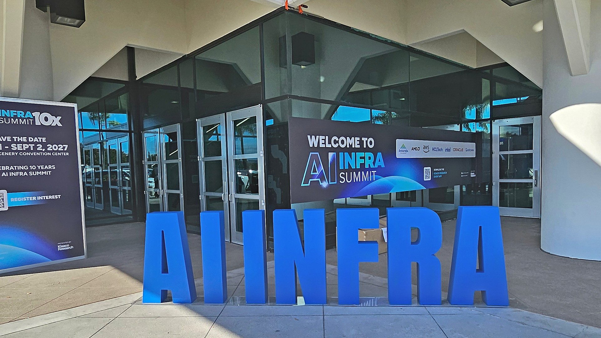

### Overview

AI Infra Summit 2026 is a global conference dedicated to AI infrastructure. It was held from September 15 to 17 at the Santa Clara Convention Center in California.

This was the ninth edition. It brought together about 8,000 attendees from around the world, more than 400 expert speakers, and over 250 partner companies. The program covered the whole AI infrastructure ecosystem, from AI Data Center, Compute, and Data Movement to Data & Models and Physical AI.

Leaders from NVIDIA, AMD, AWS, Meta, Google, and Intel spoke in the main stage keynotes. Korean sponsors included SK hynix, Samsung Electronics, Rebellions, FuriosaAI, MangoBoost, Moreh, and HyperAccel.

### HyperAccel's Presence: Gold Sponsor and Our First Standalone Booth

HyperAccel took part as a Gold Sponsor and ran its first standalone booth on a global stage. At the booth, we showed a live demo of BERTHA, our LLM Processing Unit (LPU). On the first day, September 15, CEO Juyoung Kim presented HyperAccel's vision for AI infrastructure built around token efficiency in a Compute Track session.

## Four Trends Running Through the Global AI Infrastructure Market

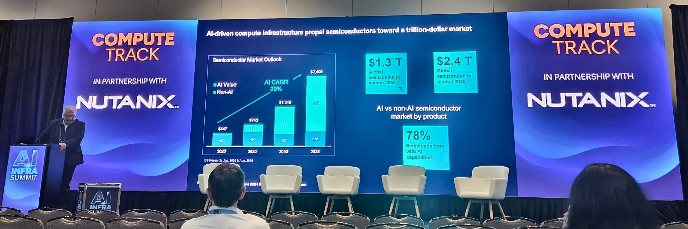

▲ The main stage at AI Infra Summit 2026

Big tech companies such as Google, Meta, and AWS are expanding their data center investments aggressively to meet surging inference demand. But one message came up again and again at this event. What limits data center expansion now is power, cooling, and cost per token, more than the amount of compute.

Big tech and global chip companies are raising data center efficiency with rack-level integrated systems and power optimization. Meanwhile, Korean AI chip companies such as FuriosaAI, Rebellions, and HyperAccel are seeking entry into the global market with inference-specialized architectures and Sovereign AI demand. Here are the four trends we saw on the floor.

### ① The bottleneck is capacity, power, and token cost ($/token), not the model

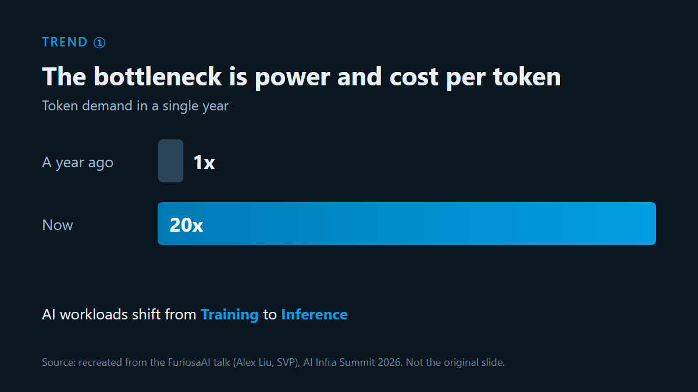

▲ Diagram recreated from the FuriosaAI talk: the shift of AI workloads to inference, and the power and token cost bottleneck

- Global AI workloads are shifting quickly from training to inference. According to FuriosaAI's talk (Alex Liu, SVP), token demand grew 20 times in a single year.
- The key question for AI infrastructure is no longer "How big a compute farm can we build?" It is "How much useful AI work can we get from each unit of compute?" GPU-first infrastructure is hitting limits in power and cooling. That makes the need for inference-dedicated architectures, which maximize token efficiency per watt and per dollar, clearer than ever.

### ② The rack-scale race beyond "just chips" and the rise of Sovereign AI

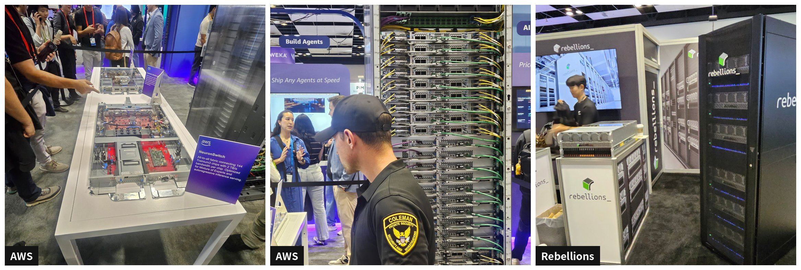

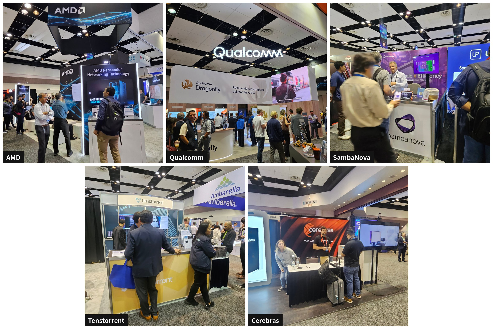

▲ Rack-scale systems from major AI chip and infrastructure companies, as seen on the floor

- **Rack-scale strategies of global chip companies:** AMD (Helios rack-scale platform) and Qualcomm (Dragonfly lineup) put rack-level system optimization front and center. Challengers such as Tenstorrent (a live Galaxy Blackhole system), SambaNova, and Cerebras also made their presence felt. Each ran a consultation-focused booth built on its own architecture and demos.

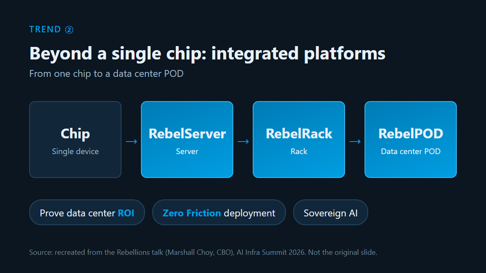

▲ Diagram recreated from the Rebellions talk: Sovereign AI and the rack-scale (RebelRack/RebelPOD) integrated platform

- **Sovereign AI and the response of Korean companies:** Building Sovereign AI infrastructure that guarantees data sovereignty for countries and companies was a key topic, as was moving into commercialized, deployed products. Rebellions presented an integrated platform that goes beyond a single chip, from servers (RebelServer) and racks (RebelRack) to data center PODs (RebelPOD). It stressed that proving data center ROI and zero-friction deployment is the decisive criterion for entering the market.

### ③ Power optimization, Extreme Co-design, and the infrastructure ecosystem

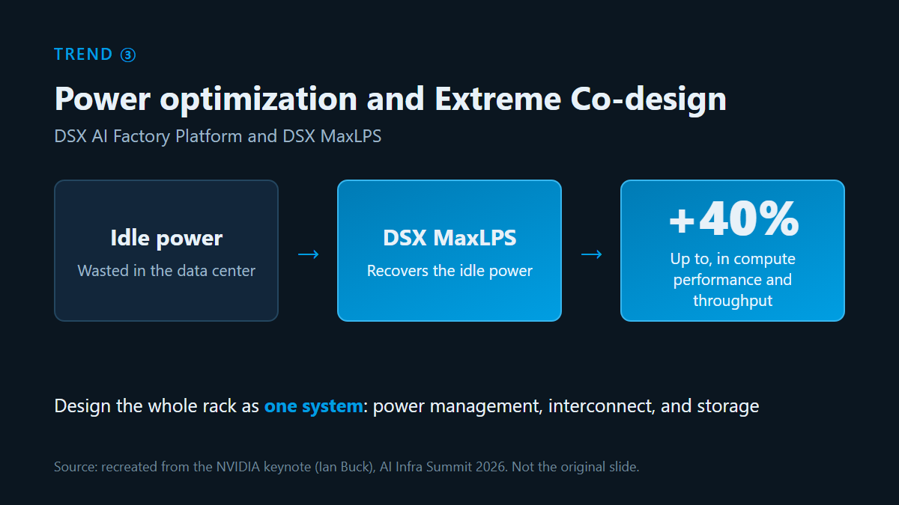

▲ Diagram recreated from NVIDIA's Ian Buck keynote: data center power optimization with DSX MaxLPS, and Extreme Co-design

- In his keynote, NVIDIA's Ian Buck unveiled the DSX AI Factory Platform and DSX MaxLPS. The approach recovers idle power that data centers would otherwise waste, and it can deliver up to 40% higher compute performance and throughput.
- Integrations with Vera Rubin, Groq 3 LPX, and d-Matrix point the same way. The focus is moving beyond single-chip performance to designing the whole rack as one system, including power management, interconnect, and storage (Extreme Co-design).

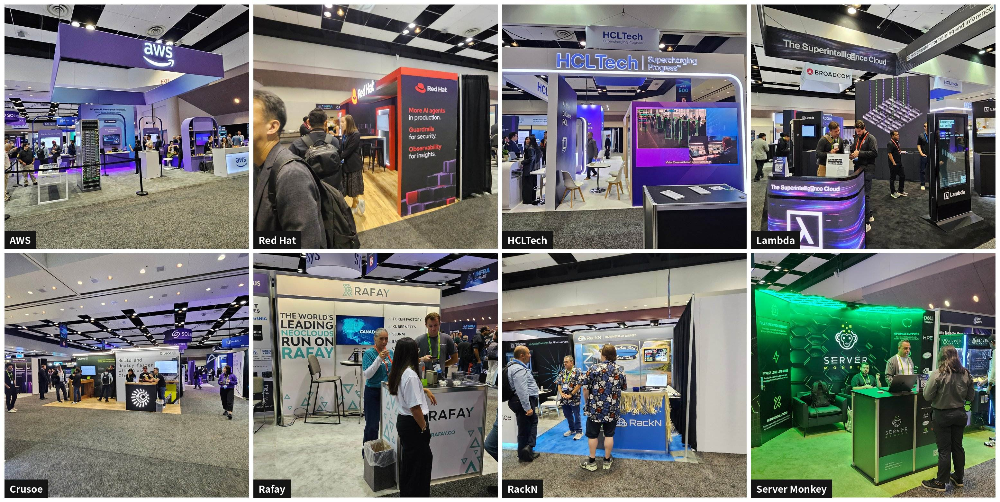

▲ Booths in the AI cloud, agent operations, and infrastructure procurement ecosystem (clockwise from top left: AWS, Red Hat, HCLTech, Lambda, Server Monkey, RackN, Rafay, Crusoe)

- **The AI cloud and infrastructure operations ecosystem:** AI cloud companies such as AWS, Lambda, and Crusoe went beyond performance competition. They led with what enterprise customers actually need to adopt: security certifications (SOC 2, ISO 27001), ROI, and cost control. Operations and procurement partners such as Rafay, Server Monkey, and RackN built their messages around a 'Token Factory' and fast GPU server procurement. Together they showed that token processing efficiency and procurement speed have become core axes of infrastructure competitiveness.

### ④ Prefill/Decode disaggregation and low latency become standard

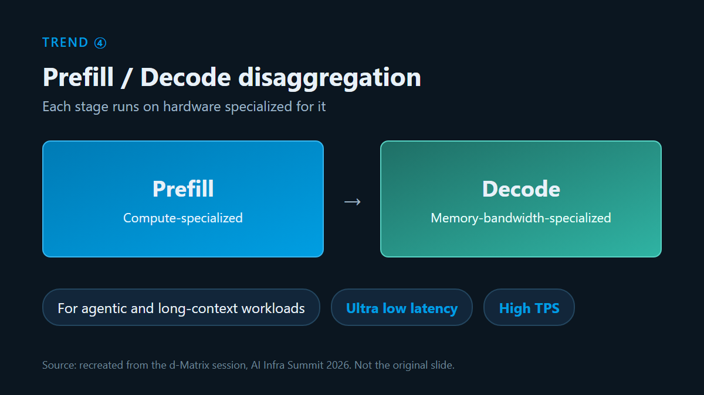

▲ Diagram recreated from the d-Matrix session: an ultra low latency architecture based on Disaggregated Inference

- **d-Matrix session:** Agentic workloads and long-context processing keep growing. In response, an architecture that places the Prefill stage on compute-specialized hardware and the Decode stage on memory-bandwidth-specialized hardware is becoming the standard for AI data centers. It achieves ultra low latency and high TPS at the same time.

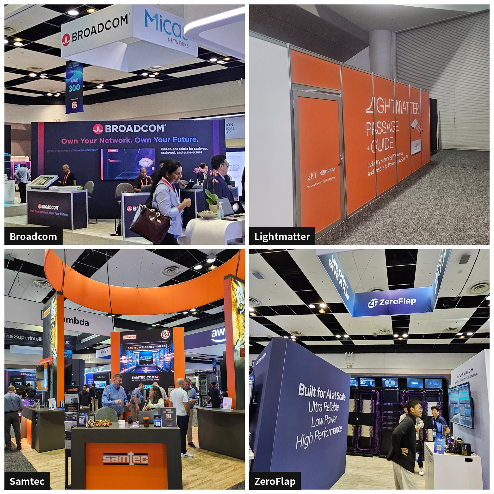

▲ Booths of leading interconnect companies (clockwise from top left: Broadcom, Lightmatter, ZeroFlap, Samtec)

- **Data Movement & Interconnect**
  - **Broadcom:** presented an integrated fabric solution for scale-up and scale-out
  - **Lightmatter:** pursued B2B partnerships centered on private meeting rooms, with its 'Passage + Guide' products
  - **ZeroFlap & Samtec:** demonstrated low-power PCIe Gen6 connectivity and next-generation copper and optical fabrics

## HyperAccel's Answer: Token-Efficient AI Infrastructure

### 1. CEO Talk: Token Prices Are Falling, So Why Do AI Service Costs Keep Rising?

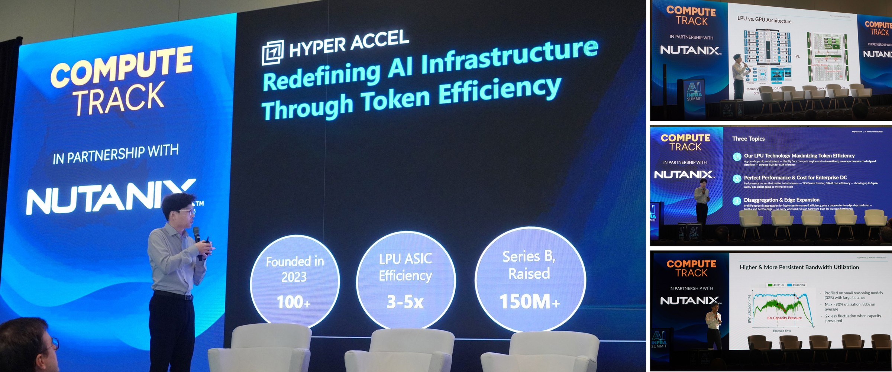

▲ HyperAccel CEO Juyoung Kim presenting

On September 15, the first day, CEO Juyoung Kim gave a talk titled "Redefining AI Infrastructure Through Token Efficiency" in the Compute Track. The core of the talk was a new way to look at AI inference cost.

The price per token is falling fast. Ironically, the cost of building and running AI services is rising sharply for real companies. Completing one complex task now needs far more tokens in total. Reasoning tokens are generated while a model thinks through the task. Agentic tokens are consumed when agents call tools. The context window also keeps growing.

Lowering the price per token is therefore not enough. The real challenge is building infrastructure that processes tokens efficiently across the whole inference process. HyperAccel presented three approaches for this.

- **Token Efficiency:** We introduced an LPU architecture optimized for LLM inference. A Big Core compute engine and a Streamlined Dataflow, based on memory-compute co-design, maximize memory bandwidth utilization. The LPU reaches 83% bandwidth utilization on average in LLM inference, and over 90% at peak.
- **Enterprise Performance & Cost:** We shared BERTHA's results on the metrics that matter for enterprise AI infrastructure: throughput (TPS), power efficiency, and TCO. Depending on the workload and the comparison target, we showed efficiency gains of up to 3 to 5 times per watt and per dollar.
- **Disaggregation & Edge:** We showed an architecture that separates the Prefill and Decode stages to maximize inference performance and efficiency. We also showed a product roadmap that runs from BERTHA for data centers to BERTHA-Edge for on-device AI.

Right after the talk, many attendees visited our booth. They watched BERTHA run inference in real time and discussed whether it could fit their own infrastructure.

For a detailed summary of the talk, see the [HyperAccel LinkedIn post](https://www.linkedin.com/feed/update/urn:li:activity:7506366519862300672).

### 2. BERTHA Live Demo: Proving AI Performance Right in Front of Visitors

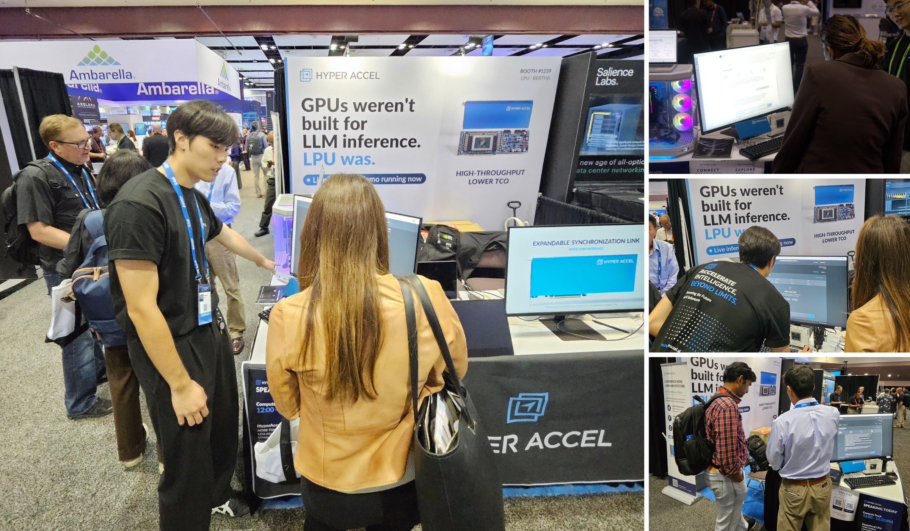

▲ The HyperAccel LPU live demo at the booth

Even with our booth located deeper inside the hall, the real-time demo, running actual LLM inference, caught visitors' eyes. More than 300 AI infrastructure professionals visited the booth over the three days. Their interest turned into technical discussions and business talks.

A deep-tech product like an AI chip is hard to sell by explaining its architecture or spec sheet alone. That changes the moment people see working hardware and its performance with their own eyes. Visitors grasped how realistic the technology is and began asking how to apply it in their own environments.

Data center operators, cloud companies, and server distributors visited the booth to check whether adopting the LPU made sense for them. Ian Cutress (TechTechPotato), a global tech content creator, also visited. He covered the BERTHA live demo and interviewed us.

The experience confirmed once more that what matters more than booth size or location is how intuitively you let people experience the product's value, and whether that experience turns into real collaboration.

🔗 For live sketches from the floor, see **\[[*Day 1 on the floor*](https://www.linkedin.com/feed/update/urn:li:activity:7506005768014561280)\]** and **\[[*Day 2 live demo*](https://www.linkedin.com/feed/update/urn:li:activity:7506382400264929280)\]**.  
🎬 On-site coverage video: [***TechTechPotato: HyperAccel BERTHA live demo and on-site interview***](https://www.linkedin.com/feed/update/urn:li:activity:7507628607909830656)

## Closing: What AI Infra Summit 2026 Left Us With

The structural shifts we saw in the global AI infrastructure market at AI Infra Summit 2026 come down to two points.

- **A paradigm shift from "scaling compute" to "maximizing tokens per unit of power"**

  Token demand surged in a single year. The main bottleneck in data centers has moved from model size to power limits and cost per token ($/token). Infrastructure competition will now be won by architectures that maximize token efficiency per watt and per dollar, not by chip specs.
- **From the era of paper specs to the era of real workload validation**

  In the B2B AI infrastructure market, theoretical peak FLOPS and spec sheets alone no longer persuade customers. Results that can be verified on the floor now drive global customers' adoption decisions. Examples are real-time inference demos on real LLM workloads, a dataflow design that maximizes memory efficiency, and a Prefill/Decode disaggregated architecture.

HyperAccel will keep building on its LPU technology. Our goal is to offer the most efficient AI inference solution in the global AI infrastructure market.

For questions about BERTHA's technical specifications or building LPU-based inference infrastructure, please contact us through the [HyperAccel official channel](https://hyperaccel.ai/contact/).

✉️ **Contact:** [contact@hyperaccel.ai](mailto:contact@hyperaccel.ai)  
🔗 **LinkedIn:** [HyperAccel Official LinkedIn](https://www.linkedin.com/company/hyperaccel)  
🌐 **Website:** [www.hyperaccel.ai](https://www.hyperaccel.ai)

---

## P.S.

### Join HyperAccel

HyperAccel develops the LPU, an AI chip for LLM inference, and BERTHA, a server built on it. We are looking for teammates to help us turn this global momentum into industry-defining products. If you are interested, please apply anytime.

**Career Site**: [https://hyperaccel.career.greetinghr.com/en/guide](https://hyperaccel.career.greetinghr.com/en/guide)
