안녕하세요. HyperAccel Marketing 박소영입니다.

AI 모델이 고도화되고 적용 범위가 넓어질수록, 이를 실제로 구동하고 운영하는 AI 추론 인프라(Inference Infrastructure)의 중요성이 그 어느 때보다 커지고 있습니다. 특히 엔터프라이즈 환경에서는 단순한 모델 성능을 넘어 LLM 추론 비용, 전력 소비량, 시스템 전체의 TCO(총소유비용)가 서비스의 성패를 가르는 핵심 지표가 되었습니다.

지난 9월, 미국 실리콘밸리 산타클라라에서 열린 AI Infra Summit 2026 현장에서 확인한 글로벌 AI 추론 시장의 흐름과, HyperAccel이 LPU BERTHA를 통해 제시한 AI 인프라의 방향을 공유합니다.

**💡 이번 글은 다음과 같은 분들께 추천합니다:**

- AI 반도체와 LLM 추론 시장의 최신 흐름이 궁금한 분
- 글로벌 AI 인프라 기업들의 기술 및 사업 전략을 살펴보고 싶은 분
- 실제 LLM 서비스 적용을 위해 LPU 기반 추론 인프라 도입을 검토 중인 분

## AI Infra Summit 2026 소개

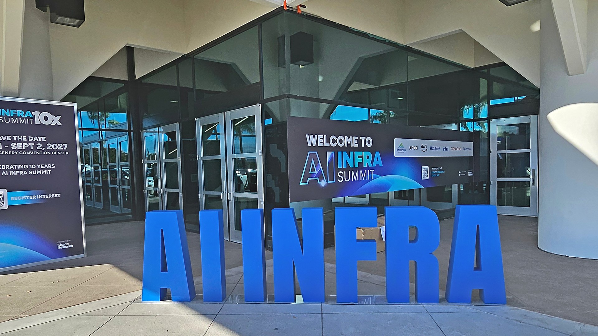

### 행사 개요

AI Infra Summit 2026은 9월 15일부터 17일까지 미국 캘리포니아주 산타클라라 컨벤션센터에서 개최된 글로벌 AI 인프라 전문 컨퍼런스입니다.

올해로 9회째를 맞이한 이번 행사에는 약 8,000명의 글로벌 참관객, 400여 명의 전문 연사, 그리고 250여 개 파트너사가 한자리에 모였습니다. AI Data Center부터 Compute, Data Movement, Data & Models, Physical AI에 이르기까지 AI 인프라 생태계 전반을 아우르는 최신 기술 트렌드와 전략이 다양하게 논의되었습니다.

메인 스테이지 키노트에는 NVIDIA, AMD, AWS, Meta, Google, Intel 등 글로벌 빅테크 기업의 리더들이 연사로 나섰으며, 국내에서는 SK하이닉스, 삼성전자, 리벨리온, 퓨리오사AI, 망고부스트, 모레, HyperAccel 등이 스폰서로 참여했습니다.

### HyperAccel's Presence: 골드 스폰서 참여 및 첫 단독 부스 운영

HyperAccel은 이번 행사에 골드 스폰서(Gold Sponsor)로 참여해 글로벌 무대에서 처음으로 단독 부스를 운영했습니다. 부스에서는 LPU(LLM Processing Unit) BERTHA의 실시간 라이브 데모를 선보였고, 행사 첫날인 9월 15일에는 Compute Track 세션에서 김주영 대표가 토큰 효율성 중심의 AI 인프라 비전을 발표했습니다.

## 글로벌 AI 인프라 시장을 관통하는 4가지 트렌드

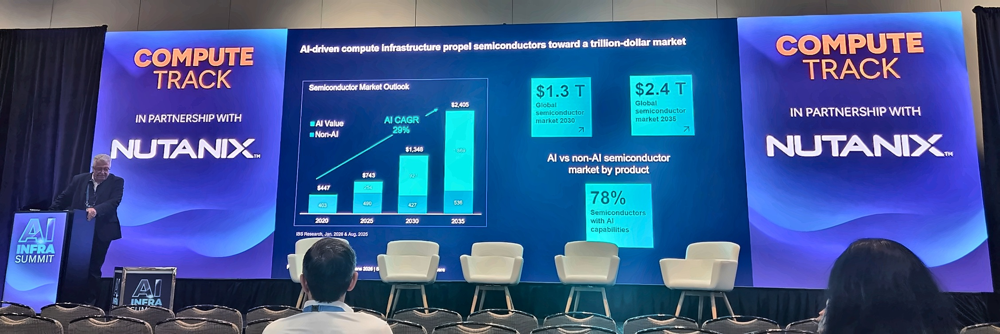

▲ AI Infra Summit 2026 메인 스테이지 현장 전경

Google, Meta, AWS 등 글로벌 빅테크는 급증하는 추론 수요에 대응하기 위해 데이터센터 투자를 공격적으로 늘리고 있습니다. 그러나 이번 행사에서 반복적으로 확인된 메시지는, 이제 데이터센터 확장의 한계를 결정하는 것은 연산 자원의 양보다 전력과 냉각, 그리고 토큰당 비용이라는 점이었습니다.

빅테크와 글로벌 칩 기업들이 랙 단위 통합 시스템과 전력 최적화로 데이터센터 효율을 끌어올리는 사이, 퓨리오사AI와 리벨리온, HyperAccel 등 국내 AI 반도체 기업들은 추론 특화 아키텍처와 Sovereign AI 수요를 앞세워 글로벌 시장 진입을 모색하고 있습니다. 현장에서 확인한 4가지 흐름을 정리했습니다.

### ① 병목은 모델이 아니라 용량, 전력, 그리고 토큰 비용($/token)

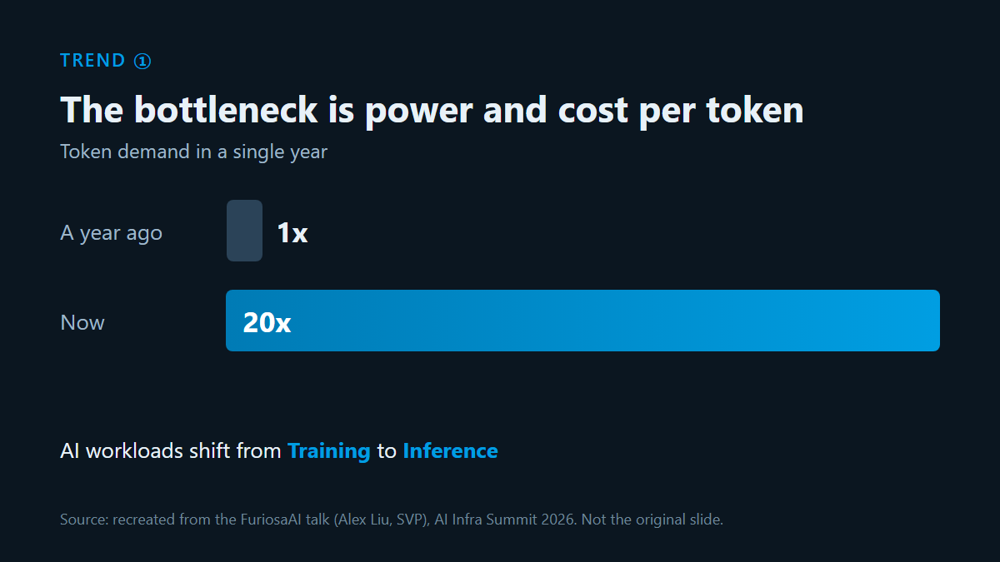

▲ FuriosaAI 발표 내용을 바탕으로 재구성한 도식: AI 워크로드의 추론 전환과 전력/토큰 비용 병목

- 글로벌 AI 워크로드는 학습(Training)에서 추론(Inference) 중심으로 빠르게 전환되고 있습니다. FuriosaAI 발표(Alex Liu, SVP)에 따르면 1년 만에 토큰 수요가 20배 급증했습니다.
- 이제 AI 인프라의 핵심 질문은 "컴퓨팅 파워를 얼마나 크게 지을 것인가?"가 아니라 "단위 컴퓨트당 얼마나 많은 유용한 AI 작업을 뽑아낼 수 있는가?"입니다. GPU 중심(GPU-first) 인프라가 전력과 냉각의 한계에 부딪히면서, 와트·달러당 토큰 효율을 극대화하는 추론 전용 아키텍처의 필요성이 그 어느 때보다 분명해졌습니다.

### ② '단순 칩'을 넘어선 랙 스케일(Rack-Scale) 경쟁과 Sovereign AI의 부상

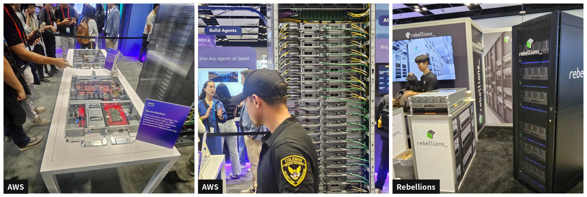

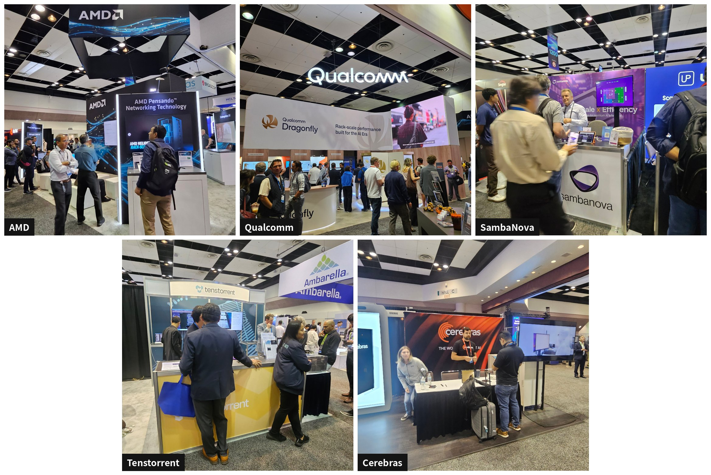

▲ 주요 AI 반도체 및 인프라 기업들의 랙 스케일(Rack-Scale) 시스템 현장 스케치

- **글로벌 칩 기업들의 랙 스케일 전략:** AMD(Helios 랙 스케일 플랫폼)와 Qualcomm(Dragonfly 라인업)은 랙 단위 시스템 최적화를 전면에 내세웠습니다. Tenstorrent(Galaxy Blackhole 시스템 실물 시연), SambaNova, Cerebras 등 도전자 기업들도 각자의 아키텍처와 시연을 기반으로 상담 중심 부스를 운영하며 존재감을 드러냈습니다.

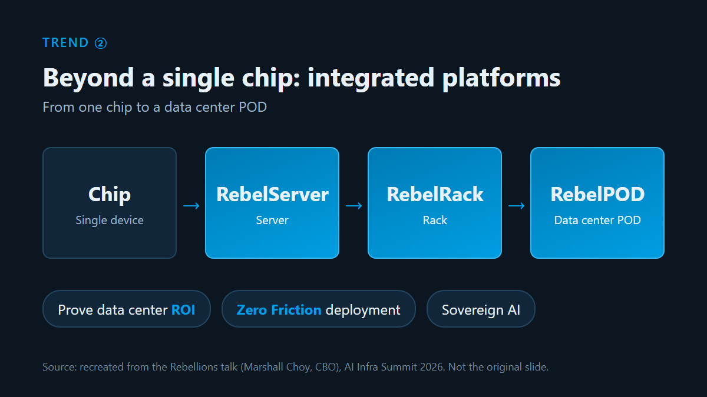

▲ Rebellions 발표 내용을 바탕으로 재구성한 도식: Sovereign AI 및 랙 스케일(RebelRack/RebelPOD) 통합 플랫폼

- **Sovereign AI와 국내 기업의 대응:** 국가 및 기업별 데이터 주권을 보장하는 Sovereign AI 인프라 구축과 실제 상용화·양산(Commercialized/Deployed) 단계 진입도 핵심 화두였습니다. 리벨리온은 단품 칩을 넘어 서버(RebelServer), 랙(RebelRack), 데이터센터 POD(RebelPOD) 단위의 통합 플랫폼을 제시하며, 데이터센터 ROI와 즉시 배포 가능성(Zero Friction)을 입증하는 것이 시장 진입의 결정적 기준이라고 강조했습니다.

### ③ 전력 효율 최적화(Power Optimization)와 Extreme Co-design, 그리고 인프라 생태계

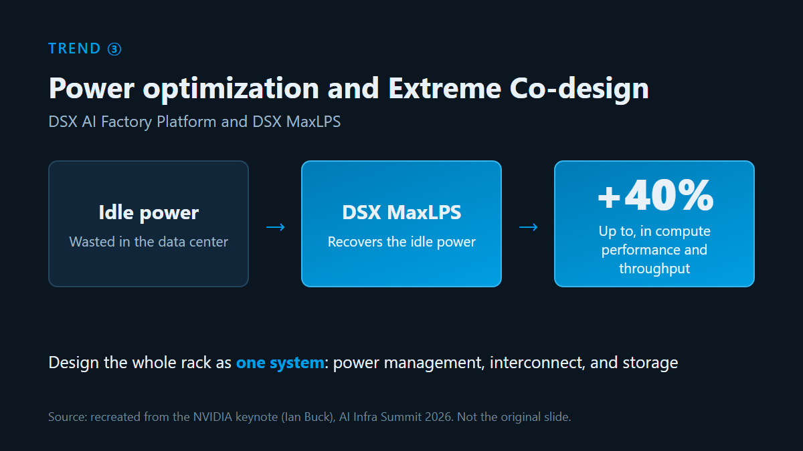

▲ NVIDIA Ian Buck 키노트 내용을 바탕으로 재구성한 도식: DSX MaxLPS 기반 데이터센터 전력 최적화 및 Extreme Co-design

- NVIDIA Ian Buck은 키노트에서 DSX AI Factory Platform과 DSX MaxLPS 기술을 공개하며, 데이터센터에서 버려지는 유휴 전력을 회수해 최대 40% 더 높은 컴퓨트 성능과 처리량(Throughput)을 얻는 방안을 제시했습니다.
- Vera Rubin, Groq 3 LPX, d-Matrix 등과의 연동 사례에서 보듯, 이제 개별 칩 성능을 넘어 전력 관리, 인터커넥트, 스토리지까지 랙 전체를 하나의 시스템으로 설계(Extreme Co-design)하는 방향으로 진화하고 있습니다.

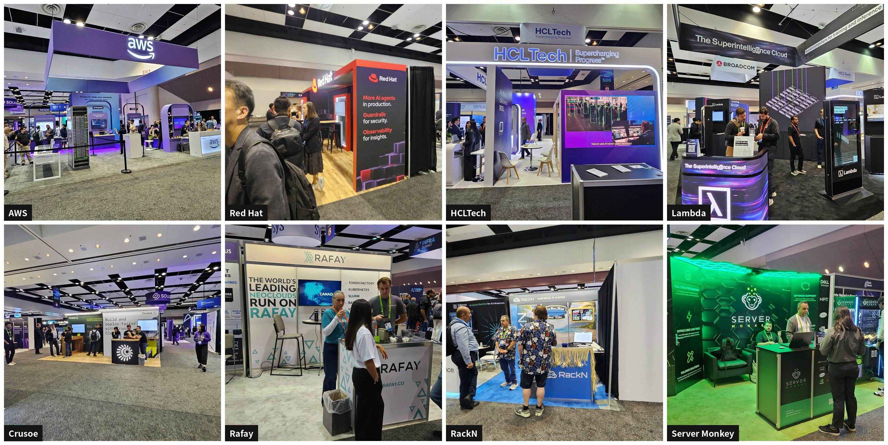

▲ AI 클라우드, 에이전트 운영 및 인프라 조달 생태계 부스 현장 스케치 (좌측 상단부터 시계방향: AWS, Red Hat, HCLTech, Lambda, Server Monkey, RackN, Rafay, Crusoe)

- **AI 클라우드 및 인프라 운영 생태계:** AWS, Lambda, Crusoe 등 AI 클라우드 기업들은 성능 경쟁을 넘어 보안 인증(SOC 2, ISO 27001), ROI, 비용 통제 등 기업 고객의 실질적인 도입 요건을 앞세웠습니다. Rafay, Server Monkey, RackN 등 운영·조달 파트너사들도 'Token Factory'와 'GPU 서버 빠른 조달'을 주요 메시지로 내걸며, 토큰 처리 효율과 조달 속도가 인프라 경쟁력의 핵심 축이 되었음을 보여주었습니다.

### ④ Prefill / Decode 분리(Disaggregation)와 저지연(Low Latency)의 표준화

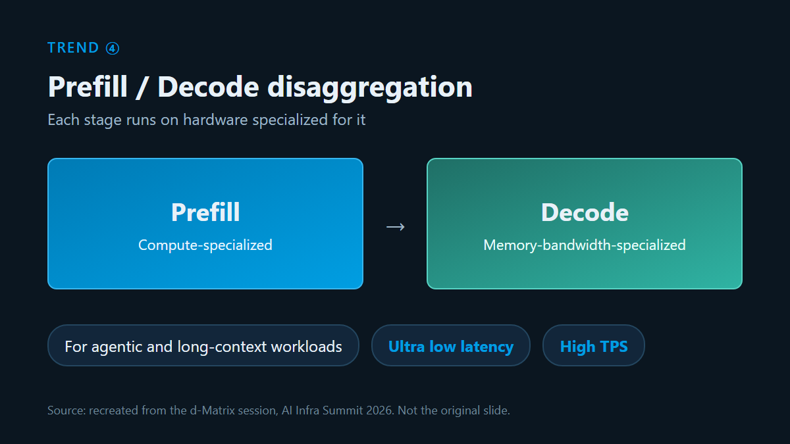

▲ d-Matrix 세션 내용을 바탕으로 재구성한 도식: Disaggregated Inference 기반 Ultra Low Latency 아키텍처

- **d-Matrix 세션:** 에이전틱(Agentic) 워크로드와 Long-Context 처리가 늘어나면서, Prefill 단계는 연산 특화 영역에, Decode 단계는 메모리 대역폭 특화 영역에 분리 배치해 Ultra Low Latency와 높은 TPS를 동시에 달성하는 아키텍처가 AI 데이터센터의 표준으로 자리 잡고 있음을 다루었습니다.

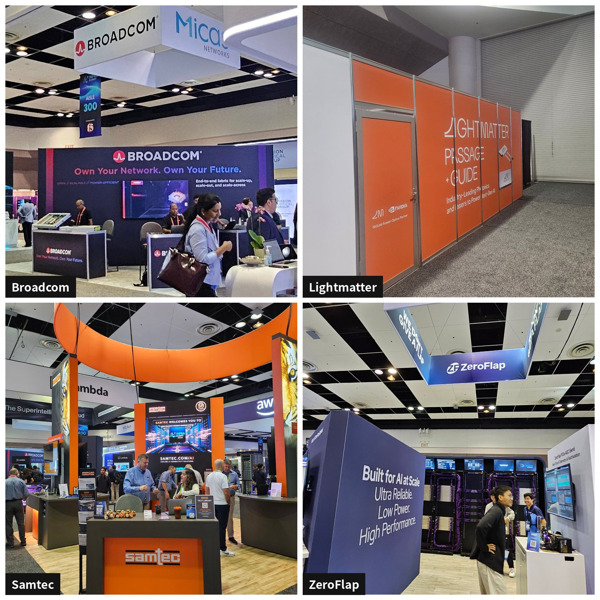

▲ 인터커넥트(Interconnect) 주요 기업 부스 현장 스케치 (좌측 상단부터 시계방향: Broadcom, Lightmatter, ZeroFlap, Samtec)

- **Data Movement & Interconnect**
  - **Broadcom:** 스케일업/스케일아웃을 위한 통합 패브릭 솔루션 제시
  - **Lightmatter:** 'Passage + Guide' 프라이빗 미팅룸 중심의 B2B 파트너십 전개
  - **ZeroFlap & Samtec:** PCIe Gen6 기반 저전력 연결 및 차세대 구리/광 패브릭 시연

## HyperAccel이 제시한 해법: 토큰 효율 중심의 AI 인프라

### 1. CEO 발표: 토큰 가격은 낮아지는데, 왜 AI 서비스 비용은 늘어날까?

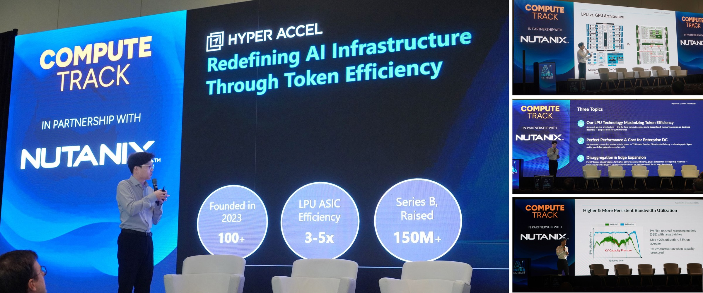

▲ HyperAccel 김주영 대표 발표 모습

행사 첫날인 9월 15일, HyperAccel 김주영 대표는 Compute Track 세션에서 "Redefining AI Infrastructure Through Token Efficiency"를 주제로 발표했습니다. 발표의 핵심은 'AI 추론 비용을 바라보는 새로운 시각'이었습니다.

현재 토큰당 단가는 빠르게 낮아지고 있지만, 아이러니하게도 기업들의 실제 AI 서비스 구축·운영 비용은 오히려 급증하고 있습니다. 하나의 복잡한 작업을 완수하기 위해 생성되는 추론 토큰(Reasoning Tokens), 에이전트가 툴을 호출하며 소비하는 에이전틱 토큰(Agentic Tokens), 그리고 점점 길어지는 컨텍스트 윈도우(Context Window)로 인해 작업 1건당 처리해야 할 전체 토큰 수가 폭발적으로 늘어났기 때문입니다.

결국 토큰당 단가를 낮추는 단편적인 접근을 넘어, 전체 추론 과정에서 토큰을 얼마나 효율적으로 처리할 수 있는 인프라를 구축하느냐가 핵심 과제입니다. HyperAccel은 이를 위한 3가지 접근 방식을 제시했습니다.

- **Token Efficiency (토큰 효율성):** LLM 추론에 최적화된 LPU 아키텍처를 소개했습니다. Big Core 연산 엔진과 메모리·연산 공동 설계(Co-design) 기반의 Streamlined Dataflow를 통해 메모리 대역폭 활용률을 극대화했으며, LLM 추론 시 평균 83%, 최대 90% 이상의 대역폭 활용률을 달성했습니다.
- **Enterprise Performance & Cost (성능 및 비용):** 엔터프라이즈 AI 인프라의 핵심 지표인 처리량(TPS), 전력 효율, TCO 관점에서 BERTHA의 성능을 공유했습니다. 워크로드와 비교 대상에 따라 와트·달러당 최대 3\~5배 수준의 효율 개선이 가능함을 보여주었습니다.
- **Disaggregation & Edge (아키텍처 및 엣지 확장성):** Prefill과 Decode 단계를 분리해 추론 성능과 효율을 극대화하는 아키텍처 구성과 함께, 데이터센터용 BERTHA부터 온디바이스 AI용 BERTHA-Edge까지 이어지는 제품 로드맵을 선보였습니다.

발표 직후 많은 참석자들이 HyperAccel 부스를 찾아 BERTHA의 실시간 추론 시연을 참관하고 자사 인프라 적용 가능성을 논의했습니다.

자세한 발표 요약은 [HyperAccel 공식 LinkedIn 발표 요약 게시글](https://www.linkedin.com/feed/update/urn:li:activity:7506366519862300672)에서 확인하실 수 있습니다.

### 2. BERTHA 라이브 데모: 눈앞에서 직접 증명한 AI 성능

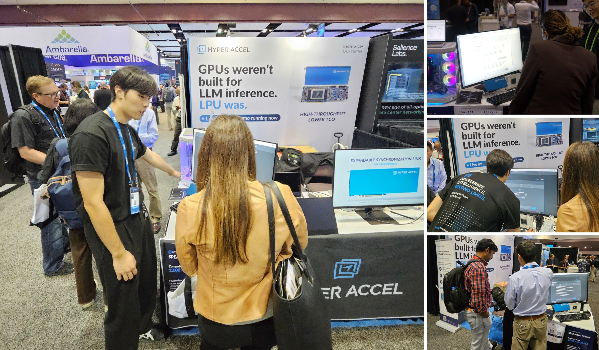

▲ HyperAccel LPU Live Demo 시연 현장

HyperAccel 부스는 전시장 안쪽에 위치했음에도 불구하고, 실제 LLM 추론이 구동되는 실시간 시연을 통해 방문객들의 시선을 사로잡았습니다. 행사 기간 3일 동안 300명 이상의 AI 인프라 관계자가 부스를 찾았고, 현장의 관심은 기술 논의와 비즈니스 상담으로 이어졌습니다.

AI 반도체처럼 깊은 기술적 이해가 필요한 딥테크 제품은 아키텍처나 스펙 시트만으로는 실제 도입 효과를 체감하기 어렵습니다. 하지만 작동하는 실물과 성능을 눈으로 직접 확인하는 순간 달라집니다. 방문객들은 기술의 현실성을 즉각 이해하고, 자사 인프라 환경에 적용할 구체적인 방법을 질문하기 시작했습니다.

데이터센터 사업자, 클라우드 기업, 서버 유통사 등 다양한 분야의 고객들이 부스를 방문해 LPU 도입 타당성을 확인했습니다. 글로벌 기술 콘텐츠 제작자인 Ian Cutress(TechTechPotato)도 부스를 찾아 BERTHA 라이브 데모를 취재하고 인터뷰를 진행했습니다.

전시 공간의 규모나 위치보다 중요한 것은 **'제품의 가치를 얼마나 직관적으로 경험하게 만드느냐'**, 그리고 그 경험을 '실질적인 협력 기회로 이어가느냐'라는 점을 다시 한번 확인한 계기였습니다.

🔗 생생한 현장 스케치는 **\[[*Day 1 현장 기록*](https://www.linkedin.com/feed/update/urn:li:activity:7506005768014561280)\]** 과 **\[[*Day 2 라이브 데모 현장*](https://www.linkedin.com/feed/update/urn:li:activity:7506382400264929280)\]** 에서 확인하실 수 있습니다.  
🎬 현장 취재 영상: [***TechTechPotato HyperAccel BERTHA 라이브 데모 시연 & 현장 취재***](https://www.linkedin.com/feed/update/urn:li:activity:7507628607909830656)

## 마치며: AI Infra Summit 2026이 남긴 시사점

이번 AI Infra Summit 2026에서 확인한 글로벌 AI 인프라 시장의 구조적 변화는 다음 두 가지로 정리할 수 있습니다.

- **'컴퓨팅 파워 확장'에서 '단위 전력당 토큰 처리량 극대화'로의 패러다임 전환**

  1년 만에 토큰 수요가 폭증하면서, 데이터센터의 핵심 병목은 모델 크기가 아닌 전력 한계와 토큰당 비용($/token)으로 이동했습니다. 인프라 경쟁의 승패는 이제 칩 스펙이 아니라 와트당·달러당 토큰 효율을 극대화하는 아키텍처에 달려 있습니다.
- **스펙 시트(Paper Spec)의 시대에서 '실제 워크로드 검증'의 시대로**

  B2B AI 인프라 시장에서는 더 이상 이론적인 Peak FLOPS나 스펙 시트만으로는 고객을 설득하기 어렵습니다. 실제 LLM 워크로드 기반의 실시간 추론 데모, 메모리 효율을 극대화한 데이터플로우 설계, Prefill/Decode 분리 아키텍처처럼 현장에서 검증 가능한 결과가 글로벌 고객의 도입 결정을 이끄는 기준이 되고 있습니다.

HyperAccel은 앞으로도 LPU 기술력을 바탕으로 글로벌 AI 인프라 시장에서 가장 효율적인 AI 추론 솔루션을 제시해 나가겠습니다.

BERTHA의 기술 사양이나 LPU 기반 추론 인프라 구축에 관해 궁금한 점은 언제든 [HyperAccel 공식 채널](https://hyperaccel.ai/contact/)로 문의해 주시기 바랍니다.

✉️ **Contact:** [contact@hyperaccel.ai](mailto:contact@hyperaccel.ai)  
🔗 **LinkedIn:** [HyperAccel Official LinkedIn](https://www.linkedin.com/company/hyperaccel)  
🌐 **Website:** [www.hyperaccel.ai](https://www.hyperaccel.ai)

---

## 추신

### HyperAccel 채용 안내

HyperAccel은 LLM 추론을 위한 AI 반도체 LPU와 이를 기반으로 한 서버 BERTHA를 개발하고 있습니다. 글로벌 무대에서 만난 고객과 파트너의 관심을 실제 제품과 사업으로 이어갈 팀원을 기다리고 있습니다. 관심이 있으시다면 언제든 지원해 주세요.

**채용 사이트**: [https://hyperaccel.career.greetinghr.com/ko/guide](https://hyperaccel.career.greetinghr.com/ko/guide)
