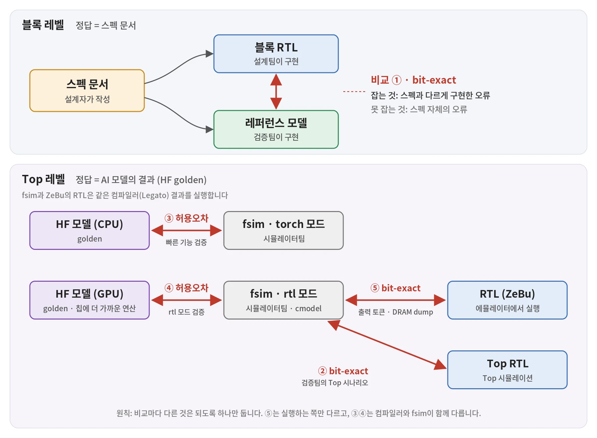

<!--
초안 표기법 (발행 전 모두 제거)
- "우리는 ~한다" 문장은 작성자가 확인한 사내 사실에만 썼습니다.
- 일반론은 일반론으로 서술했습니다.
- TODO(확인 #n): 사내 확인 필요. 브리프 4-4의 n번 항목.
- 공개 범위: fsim 명칭, 모드 이름, 팀 구조, 비교 플로우 모두 공개 가능(작성자 확인).
-->

> 이 글은 **LLM 추론 칩 검증 이야기** 시리즈의 1편입니다.
> 1편에서는 검증의 "정답"이 어디서 오는지 다룹니다.
> 2편에서는 느린 시뮬레이션의 한계를 에뮬레이터로 넘는 방법과, 언제 검증이 끝났다고 말할 수 있는지 다룹니다.

<!-- 커버 원본: images/cover.svg (수정 후 webp로 다시 내보내기) -->

## 들어가며

안녕하세요, HyperAccel DV팀 장유전입니다.
이 글에서는 **Large Language Model(LLM)** 추론 칩을 검증할 때 "정답"을 어떻게 정하는지 이야기합니다.
HyperAccel의 실제 검증 흐름을 예로 들겠습니다.

AI 모델과 칩 설계 코드(RTL)의 답이 다를 때, 누가 틀린 걸까요?

같은 프롬프트를 두 곳에 넣었다고 해 보겠습니다.
하나는 PyTorch로 돌린 AI 모델이고, 다른 하나는 우리가 설계한 칩입니다.
수십 개의 토큰이 똑같이 나오다가, 한 자리에서 다른 토큰이 나옵니다.
칩이 틀렸을까요, 모델 쪽이 틀렸을까요?
아니면 둘 다 맞은 걸까요?

소프트웨어 버그라면 고쳐서 다시 배포하면 됩니다.
칩은 그렇지 않습니다.
한 번 제조한 칩의 회로는 바꿀 수 없습니다.
버그를 고치려면 설계를 수정해 칩을 다시 찍어야 합니다.
여기에는 몇 달의 시간과 큰 비용이 듭니다.

그래서 칩은 제조 전에 설계가 맞는지 최대한 확인해야 합니다.
이 일을 **검증(verification)** 이라고 합니다.

검증이라고 하면 테스트벤치 언어나 **Universal Verification Methodology(UVM)** 같은 도구를 떠올리기 쉽습니다.
이 글은 도구 대신 더 근본적인 질문을 다룹니다.
무엇과 비교해야 "맞다"고 말할 수 있을까요?
다시 말해, 칩의 **정답** 은 어디서 올까요?

이 글의 주장은 두 가지입니다.

1. 정답은 하나가 아닙니다. 검증 레벨마다 정답의 출처가 다릅니다.
2. 각 비교는 되도록 한 가지만 다르게 합니다. 그래서 어느 비교에서 불일치가 났는지만 봐도 누구의 문제인지 알 수 있습니다.

## 검증은 결국 비교입니다

먼저 이 글에서 쓰는 용어를 정리하겠습니다.

- **Register Transfer Level(RTL)**: 칩의 동작을 기술한 설계 코드입니다. Verilog 같은 하드웨어 기술 언어로 작성하고, 시뮬레이터에서 실행해 결과를 볼 수 있습니다.
- **블록과 Top**: 칩은 여러 블록으로 나뉩니다. 블록 레벨 검증은 블록 하나를 떼어 확인합니다. Top 레벨 검증은 블록을 모두 연결한 칩 전체를 확인합니다.
- **레퍼런스 모델**: RTL과 같은 입력을 받아 기대값을 계산하는 소프트웨어입니다. RTL의 출력이 이 기대값과 같은지 비교합니다.
- **bit-exact**: 두 결과가 비트 하나까지 완전히 같다는 뜻입니다. 오차를 조금도 허용하지 않습니다.

검증은 결국 비교입니다.
같은 입력을 두 구현에 넣고 출력을 비교합니다.
둘이 다르면 어딘가에 문제가 있습니다.
그런데 무엇과 비교하느냐에 따라 찾을 수 있는 문제가 달라집니다.

<!-- 그림 #2 원본: images/comparison-chain.svg (수정 후 webp로 다시 내보내기) -->

아래 표는 이 글에서 다룰 비교 고리 전체입니다.

| # | 비교 | 기준 | 잡아내는 것 |
|---|---|---|---|
| ① | 블록 RTL ↔ 레퍼런스 모델 | bit-exact | 스펙과 다르게 구현한 오류 |
| ② | Top RTL ↔ fsim(rtl) | bit-exact | 블록 간 통합 오류, 스펙 해석 차이 |
| ③ | fsim(torch) ↔ HF golden(CPU) | 허용오차 | 스펙·알고리즘 오류, 컴파일러 오류 |
| ④ | fsim(rtl) ↔ HF golden(GPU) | 허용오차 | rtl 모드의 오류, 스펙·알고리즘 오류 |
| ⑤ | RTL(ZeBu) ↔ fsim(rtl) | bit-exact | rtl 모드와 RTL의 차이, RTL 자체의 오류 |

여기서 중요한 원칙이 하나 있습니다.
**각 고리는 되도록 한 가지만 다르게 합니다.**

소프트웨어 엔지니어라면 `git bisect` 를 떠올리면 쉽습니다.
`git bisect` 는 커밋 범위를 반씩 좁혀 버그를 만든 커밋을 찾습니다.
비교 고리도 비슷하게 동작합니다.
두 구현 사이에 다른 점이 하나뿐이면, 불일치의 원인도 그 하나로 좁혀집니다.
그래서 어느 고리가 깨졌는지만 보면 누구의 문제인지 알 수 있습니다.

다만 현실에서는 이 원칙을 지키기 어려운 고리도 있습니다.
실제 모델을 돌리는 단계에서 그런 예를 보겠습니다.

## 블록 레벨(①): 스펙 문서가 정답입니다

블록 레벨에서 정답은 **스펙 문서** 입니다.
더 정확히는, 검증자가 스펙 문서만 보고 따로 만든 레퍼런스 모델입니다.

HyperAccel은 RTL 설계와 검증을 서로 독립된 팀이 맡습니다.
블록 레벨 레퍼런스 모델은 검증자가 만듭니다.
그 기준은 RTL 스펙 정의 문서입니다.
검증자는 RTL 코드를 보고 레퍼런스 모델을 만들지 않습니다.

왜 이렇게 번거롭게 할까요?
같은 사람이 같은 생각으로 두 번 구현하면, 같은 실수를 반복하기 쉽습니다.
두 구현이 같은 실수를 공유하면 결과는 완벽히 일치합니다.
그리고 버그는 아무 경고 없이 통과합니다.
레퍼런스 모델은 RTL과 독립적으로 만들어져야 의미가 있습니다.

블록 레벨에서는 RTL과 레퍼런스 모델을 bit-exact로 비교합니다.
같은 스펙을 보고 만든 두 구현이니, 마지막 비트까지 같아야 합니다.

블록 레퍼런스 모델을 PyTorch와 비교하지는 않습니다.
블록 레벨의 정답은 스펙 하나뿐이기 때문입니다.
AI 모델과의 비교는 Top 레벨의 몫입니다.

### 팀이 나뉘어도 독립성이 깨지는 경우

팀을 나눴다고 독립성이 저절로 생기지는 않습니다.
일반적으로 다음 세 가지 경우에는 팀이 달라도 같은 오류를 공유합니다.

1. **설계자의 모델을 그대로 쓰는 경우**: 설계자가 만든 모델을 검증팀이 레퍼런스로 가져다 씁니다.
2. **모호한 스펙을 설계자에게 묻는 경우**: 스펙이 애매한 부분을 설계자에게 묻고, 그 답대로 테스트벤치를 만듭니다.
3. **RTL을 읽고 기대값을 만드는 경우**: 스펙 대신 RTL 코드를 보고 기대값을 계산합니다.

세 경우 모두 설계자의 해석이 검증 쪽으로 흘러 들어갑니다.
그러면 두 구현은 더 이상 독립적이지 않습니다.

HyperAccel의 구조는 첫째와 셋째 경우를 피합니다.
레퍼런스 모델은 검증자가 직접 만들고, 기준은 RTL이 아니라 스펙 문서입니다.

둘째 경우는 완전히 피하기 어렵습니다.
스펙 문서는 설계자가 쓰기 때문입니다.
검증자는 검증하면서 모호한 부분을 찾아 설계자에게 질문합니다.
설계자는 그 부분을 해석하고 스펙 문서를 수정합니다.

여기서 중요한 점은 답이 **스펙 문서** 에 남는다는 것입니다.
검증자가 들은 답을 테스트벤치에만 반영하지 않습니다.
수정된 문서가 다시 설계와 검증 모두의 기준이 됩니다.
정답의 출처가 문서 하나로 유지되는 셈입니다.

그래도 해석 자체는 설계자의 것입니다.
그 해석이 틀렸다면 RTL과 레퍼런스 모델이 함께 틀립니다.
이 한계를 이어서 살펴보겠습니다.

### 한계: 스펙이 틀리면 둘 다 똑같이 틀린다

블록 레벨 구조에는 분명한 한계가 있습니다.
설계자와 검증자가 **같은 스펙 문서** 를 보기 때문입니다.
그리고 그 문서는 설계자가 씁니다.

스펙 문서 자체가 틀렸다면 어떻게 될까요?
설계자는 틀린 스펙대로 RTL을 만듭니다.
검증자도 틀린 스펙대로 레퍼런스 모델을 만듭니다.
두 결과는 똑같이 틀리고, 그래서 완벽히 일치합니다.

블록 레벨 검증이 증명하는 것은 "RTL이 스펙대로 만들어졌다"입니다.
"스펙이 옳다"는 증명하지 못합니다.

스펙이 옳은지 확인하려면 스펙 문서를 거치지 않는 정답이 필요합니다.
그 정답이 Top 레벨에 있습니다.

## Top 레벨: AI 모델의 결과가 정답입니다

Top 레벨에서는 블록을 모두 연결한 칩 전체를 검증합니다.
여기서 정답은 스펙 문서가 아니라 **실제 AI 모델의 결과** 입니다.

이 정답은 스펙 문서와 출처가 다릅니다.
AI 모델은 스펙 문서를 보고 만든 것이 아니기 때문입니다.
그래서 블록 레벨이 놓친 스펙 자체의 오류가 여기서 드러납니다.

[Transformer World](/posts/what-is-the-transformers/)에서 attention 연산을 소개했습니다.
그 연산이 칩 위에서도 같은 값으로 나오는지 확인하는 곳이 바로 Top 레벨입니다.

### HF golden, fsim, 그리고 컴파일러

Top 레벨의 정답은 **Hugging Face(HF)** 에 공개된 원본 모델을 PyTorch로 실행한 결과입니다.
하드웨어도 컴파일러도 거치지 않은, 가장 바깥의 정답입니다.
검증에서는 이런 기준 결과를 **golden** 이라고 부릅니다.

다만 HF golden과 RTL을 곧바로 비교하지는 않습니다.
RTL 시뮬레이션은 LLM 전체를 돌리기에는 너무 느리고, 칩이 나오기 전에는 컴파일러를 시험해 볼 곳도 없습니다.
그래서 칩의 동작을 소프트웨어로 흉내 내는 fsim을 둡니다.
fsim은 HF golden과 RTL 사이의 큰 간격을 두 단계로 나눠, 어긋났을 때 원인을 좁히는 역할도 합니다.

fsim은 시뮬레이터팀이 만듭니다.
설계팀도 검증팀도 아닌 세 번째 팀입니다.
시뮬레이터팀도 검증팀과 마찬가지로 스펙 문서를 보고 fsim을 만듭니다.
같은 스펙에서 출발한 독립된 구현이 하나 더 있는 셈입니다.

fsim은 블록 레퍼런스 모델과도 완전히 별개의 모델입니다.
블록 레퍼런스 모델을 이어 붙여 만든 것이 아닙니다.
그래서 블록 레퍼런스 모델에 실수가 있더라도, 그 실수가 Top 레벨의 비교로 그대로 옮겨 가지 않습니다.

fsim에는 torch 모드와 rtl 모드, 두 가지 모드가 있습니다.
torch 모드는 빠른 디버깅과 기능 검증에 씁니다.
rtl 모드는 칩의 동작을 그대로 따라가는 C 모델(cmodel)로, RTL과 비트 단위까지 같은 결과를 내는 것을 목표로 합니다.

AI 모델을 칩에서 돌리려면 컴파일러가 모델을 칩이 실행할 프로그램으로 바꿔야 합니다.
HyperAccel은 자체 컴파일러인 [Legato](/posts/what-is-legato/)로 이 일을 옮겨 가는 중입니다.
Legato 이전에는 사람이 직접 작성한 어셈블리인 RefAsm(reference assembly)을 썼습니다.
이 글에서는 둘을 묶어 컴파일러라고 부르겠습니다.
fsim과 ZeBu의 RTL은 모두 이 컴파일러가 만든 프로그램을 실행합니다.

### Top 시뮬레이션(②): 값이 fsim과 똑같은가

검증팀은 AI 모델을 돌리기 전에, UVM으로 만든 빠른 Top 테스트로 블록 사이의 연결부터 확인합니다.
이 이야기는 2편에서 자세히 다루고, 여기서는 값을 비교하는 테스트를 보겠습니다.

블록 하나씩 볼 때는 드러나지 않던 통합 오류가 블록을 연결하면 값의 차이로 나타납니다.

이때 쓰는 Top 시나리오도 검증팀이 구성하고, 기대값은 rtl 모드 fsim에서 나옵니다.
Top RTL과 rtl 모드 fsim은 bit-exact로 비교합니다(표의 ②).

이 비교가 잡는 것과 못 잡는 것은 분명합니다.
Top RTL과 fsim은 서로 다른 팀이 같은 스펙 문서를 보고 만들었습니다.
그래서 둘이 다르면 같은 스펙을 서로 다르게 해석한 곳이 드러납니다.
반대로 스펙 자체가 틀렸다면 둘은 똑같이 틀리고, 이 비교를 통과합니다.
스펙 오류를 잡으려면 스펙을 거치지 않는 HF golden과 비교해야 합니다.

## 실제 모델로 쌓는 세 단계

실제 AI 모델을 돌리는 검증은 세 단계로 쌓아 올립니다.
fsim과 컴파일러를 각자 개발한 뒤, 둘을 하나의 환경에서 함께 돌리며 시작합니다.

### 1단계(③): torch 모드와 CPU golden, 기능부터 빠르게

torch 모드 fsim으로 컴파일러 결과를 실행합니다.
그리고 HF 모델을 CPU에서 돌린 golden과 비교합니다.
약간의 오차를 허용하며, 허용 범위는 같은 연산을 CPU와 GPU에서 돌렸을 때 생기는 차이 정도입니다.
빠르게 돌려 보며 기능이 맞는지부터 확인하는 단계입니다.

### 2단계(④): rtl 모드와 GPU golden, 칩에 더 가깝게

이번에는 rtl 모드 fsim으로 컴파일러 결과를 실행합니다.
그리고 HF 모델을 GPU에서 돌린 golden과 비교합니다.
GPU는 CPU보다 정밀도와 연산 방식이 칩에 더 가깝습니다.
그래서 더 정확하게 디버깅할 수 있고, rtl 모드 자체도 함께 검증됩니다.
이 비교도 약간의 오차를 허용합니다.

### 3단계(⑤): ZeBu의 RTL과 rtl 모드, 비트까지 똑같이

마지막으로 같은 컴파일러 결과를 실제 RTL에서 실행합니다.
RTL은 Synopsys의 에뮬레이터인 **ZeBu** 위에서 돌립니다.
에뮬레이터는 RTL을 전용 하드웨어에 올려 시뮬레이터보다 훨씬 빠르게 실행하는 장비입니다.
에뮬레이터 이야기는 2편에서 더 자세히 다룹니다.

이 단계에서는 rtl 모드 fsim과 ZeBu의 결과를 bit-exact로 비교합니다.
출력 토큰뿐 아니라 DRAM에 남은 데이터(DRAM dump)까지 비교합니다.
rtl 모드 fsim과 실제 RTL이 완전히 같은 결과를 내는지, RTL 자체에 문제는 없는지 확인합니다.

### 정답은 한 단계씩 이어진다

세 단계를 "한 가지만 다르게" 원칙으로 다시 보면 흥미롭습니다.

3단계(⑤)는 원칙이 가장 잘 지켜지는 고리입니다.
양쪽 모두 같은 컴파일러 결과를 실행하고, 실행하는 쪽만 fsim에서 RTL로 바뀝니다.
그래서 불일치가 나면 원인은 rtl 모드 fsim과 RTL 사이로 좁혀집니다.

반대로 1, 2단계(③, ④)는 원칙에서 벗어납니다.
HF golden과 비교하면 컴파일러와 fsim, 두 가지가 함께 다르기 때문입니다.
불일치가 나도 이 비교만으로는 어느 쪽이 틀렸는지 알 수 없습니다.

그래서 이 단계에서는 HF golden을 기준으로 분석해 어느 쪽이 틀렸는지 판단합니다.
최종 출력만 보지 않고 레이어별 중간 결과까지 golden과 맞춰 봅니다.
어느 레이어에서 처음 어긋나는지 보면 원인을 좁힐 수 있습니다.
원칙을 지키지 못한 고리에는 이런 분석 비용이 따릅니다.
고리를 나누는 원칙이 왜 중요한지 거꾸로 보여 주는 예입니다.

정리하면 정답은 한 단계씩 이어집니다.
HF golden이 fsim의 정답이 되고, rtl 모드 fsim은 다시 RTL의 정답이 됩니다.

이 역할 분담은 CPU 검증과 비슷합니다.
일반적으로 CPU 검증자는 각 명령어가 스펙대로 동작하는지 확인합니다.
그 명령어로 만든 프로그램의 결과는 컴파일러와 소프트웨어가 책임집니다.
칩 검증도 마찬가지입니다.
칩이 스펙대로 동작하는지는 RTL과 fsim의 bit-exact 비교가 맡습니다.
모델이 제대로 돌아가는지는 컴파일러를 거친 HF golden과의 비교가 맡습니다.

## 허용오차는 작은 버그를 숨깁니다

앞의 비교 표에서 기준 칸을 다시 보겠습니다.
RTL이 직접 걸린 비교는 모두 bit-exact입니다.
오차를 허용하는 것은 fsim을 HF golden과 비교하는 두 곳(③, ④)뿐입니다.
fsim과 HF golden은 둘 다 맞으면서도 마지막 비트가 다를 수 있기 때문입니다.
PyTorch조차 CPU와 GPU에서 결과가 미세하게 다릅니다.
부동소수점은 더하는 순서에 따라 결과가 달라지는데, CPU와 GPU는 연산 순서와 방식이 다르기 때문입니다.

오차를 허용하면 비교가 가능해집니다.
대신 대가가 있습니다.
**허용오차는 작은 버그를 숨깁니다.**

가상의 예를 들어 보겠습니다.
컴파일러가 특정 연산에서만 반올림 방식을 잘못 고른다고 해 봅시다.
이 오류는 결과의 마지막 비트 몇 개만 바꿉니다.
그 차이가 CPU와 GPU의 차이 정도라면, 허용오차 안에 들어가 ③과 ④를 통과합니다.
⑤는 bit-exact지만 이 오류를 잡지 못합니다.
양쪽이 같은 컴파일러 결과를 실행하기 때문입니다.

<!-- TODO(확인 #6): 공개 가능한 실제 사례가 있다면 위 가상 예시를 대체. -->

그래서 허용오차는 HF golden과 비교하는 곳에만 둡니다.
RTL을 비교하는 고리는 모두 bit-exact로 비교합니다.
허용오차가 없는 곳에서는 비트 하나의 차이도 숨을 곳이 없습니다.

두 종류의 비교는 서로의 빈틈을 메웁니다.
bit-exact 비교는 두 구현 사이의 작은 차이도 놓치지 않습니다.
하지만 양쪽이 함께 가진 오류는 잡지 못합니다.
같은 스펙에서 온 오류, 같은 컴파일러 결과에 든 오류가 그렇습니다.
HF golden과의 비교는 스펙 오류를 잡지만, 허용오차 안의 작은 오류는 놓칠 수 있습니다.

## 마치며: 어디서 어긋나면 누구를 의심할까

처음 질문으로 돌아가 보겠습니다.
AI 모델과 RTL의 답이 다를 때, 누가 틀린 걸까요?

답은 어느 고리에서 불일치가 났는지에 달려 있습니다.

- 블록 RTL과 레퍼런스 모델이 다르면, 스펙과 다르게 구현한 것입니다.
- Top 시뮬레이션에서 Top RTL과 fsim이 다르면, 블록 사이의 통합이나 스펙 해석을 의심합니다.
- fsim과 HF golden이 다르면, 스펙·알고리즘, 컴파일러, fsim을 의심하고 레이어별로 따져 가립니다.
- ZeBu의 RTL과 rtl 모드 fsim이 다르면, RTL이나 rtl 모드 fsim을 의심합니다.

이 판단이 가능한 이유는 두 가지입니다.
정답의 출처를 레벨마다 나눴고, 각 고리에서 다른 것을 되도록 하나로 줄였기 때문입니다.
칩을 다시 찍지 않기 위한 검증의 뼈대가 바로 이 구조입니다.

이 원칙은 칩 검증에만 해당하지 않습니다.
모델을 다른 프레임워크로 옮기거나, 양자화하거나, 새 하드웨어로 이식할 때도 같은 질문이 생깁니다.
무엇이 정답인지 먼저 정하고, 한 번에 한 가지만 바꿔 비교하면, 결과가 어긋났을 때 어디를 봐야 할지 알 수 있습니다.

그런데 Top 시뮬레이션은 느립니다.
긴 LLM 워크로드를 끝까지 돌리기에는 시간이 너무 오래 걸립니다.
2편에서는 이 한계를 에뮬레이터로 어떻게 넘는지 살펴봅니다.
그리고 언제 "검증이 끝났다"고 말할 수 있는지도 이야기하겠습니다.

## 추신: HyperAccel은 채용 중입니다!

칩을 다시 찍지 않으려면, 누군가는 끝까지 "정말 맞는가"를 물어야 합니다.
HyperAccel에서는 설계, 검증, 시뮬레이터, 컴파일러 팀이 각자의 정답을 들고 같은 칩을 들여다봅니다.
정답의 출처를 따지고 비교의 고리를 설계하는 일에 흥미가 있으시다면, 언제든지 지원해 주세요!

**채용 사이트**: https://hyperaccel.career.greetinghr.com/ko/guide
