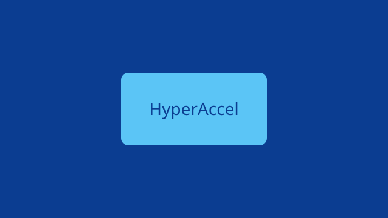
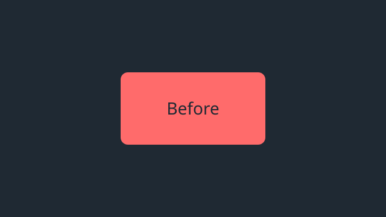
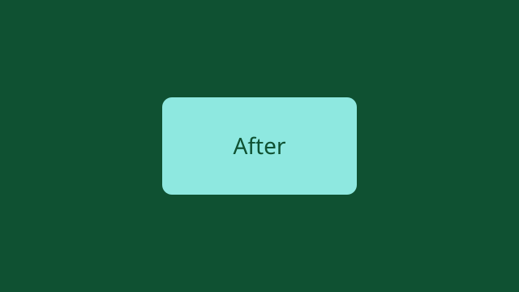

<!-- b:intro-heading -->
## Introduction

<!-- b:inline-marks -->
This post is an example decorated with each tool of the on-site editor. It holds **bold**, *italic*, <u>underline</u>, ~~strikethrough~~, <mark>highlight</mark>, <span style="color: #ff6b6b">text color</span>, <span style="background-color: #fff3bf">background color</span>, [a link](https://hyperaccel.ai), `inline code`, x<sup>2</sup>, H<sub>2</sub>O, <kbd>Ctrl</kbd>+<kbd>K</kbd>, inline math $E=mc^2$, and a footnote[^tour].

<!-- b:lead -->
An opening paragraph emphasized with a text preset.
{.lead}

<!-- b:styled -->
<span style="font-family: 'Nanum Myeongjo', serif; font-size: 20px">A sentence set in Nanum Myeongjo at 20px.</span>

<!-- b:lists-heading -->
### Lists and quotes

<!-- b:bullets -->
- First bullet
- Second bullet
  - An indented item

<!-- b:numbers -->
1. First numbered item
2. Second numbered item
3. Third numbered item

<!-- b:quote -->
> A good tool lets you forget the tool.

<!-- b:note -->
> [!NOTE] Note
> There are five kinds of callouts.

<!-- b:tip -->
> [!TIP] Tip
> Type a slash (/) to open the block menu.

<!-- b:warning -->
> [!WARNING] Warning
> Publishing needs an approved review.

<!-- b:data-heading -->
## Tables, code and math

<!-- b:table -->
| Item | Value | Note |
| --- | --- | --- |
| Throughput | 1,200 tok/s | batch 8 |
| Latency | 35 ms | first token |

<!-- b:code -->
```ts
// Time per token.
const perToken = (ms: number, tokens: number) => ms / tokens
```

<!-- b:math -->
$$
\text{throughput} = \frac{\text{tokens}}{\text{seconds}}
$$

<!-- b:blocks-heading -->
## Steps and tabs

<!-- b:steps -->

1. Load the model.
2. Build the batch.
3. Check the result.


<!-- b:tabs -->


Each tab can hold its own content.


```python
print("hello")
```



<!-- b:divider -->
---

<!-- b:media-heading -->
## Pictures and video

<!-- b:image -->


<!-- b:wide -->


<!-- b:pair -->





<!-- b:slides -->





<!-- b:compare -->





<!-- b:video -->


<!-- b:footnote -->
[^tour]: Footnotes are gathered at the end of the post.
