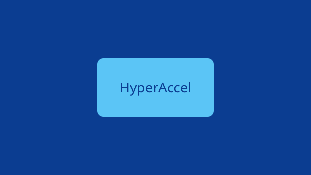
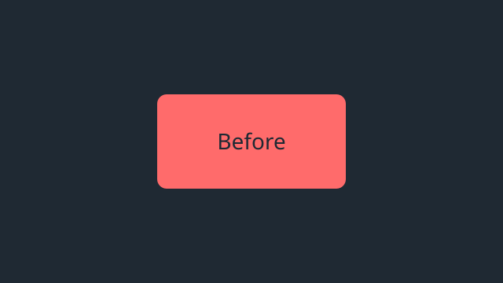
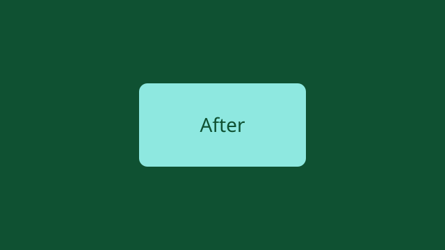

<!-- b:intro-heading -->
## 들어가며

<!-- b:inline-marks -->
이 글은 온사이트 에디터의 도구를 한 번씩 써서 꾸민 예시 글입니다. **굵게**, *기울임*, <u>밑줄</u>, ~~취소선~~, <mark>형광펜</mark>, <span style="color: #ff6b6b">글자색</span>, <span style="background-color: #fff3bf">글자 배경색</span>, [링크](https://hyperaccel.ai), `인라인 코드`, x<sup>2</sup>, H<sub>2</sub>O, <kbd>Ctrl</kbd>+<kbd>K</kbd>, 인라인 수식 $E=mc^2$, 각주[^tour]를 모두 담았습니다.

<!-- b:lead -->
글자 모양 프리셋으로 강조한 도입 문단입니다.
{.lead}

<!-- b:styled -->
<span style="font-family: 'Nanum Myeongjo', serif; font-size: 20px">나눔명조 20px로 쓴 문장입니다.</span>

<!-- b:lists-heading -->
### 목록과 인용

<!-- b:bullets -->
- 글머리 목록 첫째
- 글머리 목록 둘째
  - 들여 쓴 항목

<!-- b:numbers -->
1. 번호 목록 첫째
2. 번호 목록 둘째
3. 번호 목록 셋째

<!-- b:quote -->
> 좋은 도구는 쓰는 사람이 도구를 잊게 만듭니다.

<!-- b:note -->
> [!NOTE] 참고
> 콜아웃은 다섯 종류가 있습니다.

<!-- b:tip -->
> [!TIP] 팁
> 슬래시(/)를 입력하면 블록 메뉴가 열립니다.

<!-- b:warning -->
> [!WARNING] 주의
> 게시 전에 리뷰 승인이 필요합니다.

<!-- b:data-heading -->
## 표, 코드, 수식

<!-- b:table -->
| 항목 | 값 | 비고 |
| --- | --- | --- |
| 처리량 | 1,200 tok/s | 배치 8 |
| 지연 | 35 ms | 첫 토큰 |

<!-- b:code -->
```ts
// 토큰당 시간을 계산합니다.
const perToken = (ms: number, tokens: number) => ms / tokens
```

<!-- b:math -->
$$
\text{throughput} = \frac{\text{tokens}}{\text{seconds}}
$$

<!-- b:blocks-heading -->
## 단계와 탭

<!-- b:steps -->

1. 모델을 불러옵니다.
2. 배치를 구성합니다.
3. 결과를 확인합니다.


<!-- b:tabs -->


탭마다 다른 내용을 담을 수 있습니다.


```python
print("hello")
```



<!-- b:divider -->
---

<!-- b:media-heading -->
## 그림과 동영상

<!-- b:image -->


<!-- b:wide -->


<!-- b:pair -->





<!-- b:slides -->





<!-- b:compare -->





<!-- b:video -->


<!-- b:footnote -->
[^tour]: 각주는 글 끝에 모여 표시됩니다.
