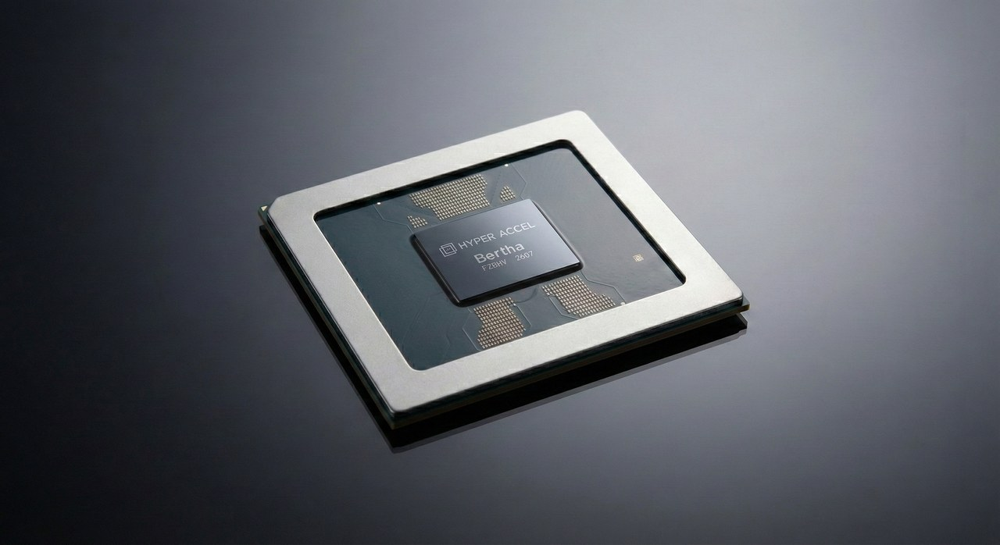

### Introduction

Hello! I'm Hyunjun Park from the CL (Compute Library) team at HyperAccel. In [Part 1]() we took `torch.compile()` apart into three components: TorchDynamo, AOTAutograd, and TorchInductor (Dynamo and Inductor from here on). Dynamo pulls a graph out of Python code, AOTAutograd tidies that graph up, and Inductor turns the tidied graph into kernels.

At the end of Part 1, I stressed that these three components are **independently replaceable**. This post starts from there. Taking Python code in and handing kernels out could have been done by a single compiler. So why did PyTorch bother splitting it into three stages? And if each stage can be swapped out, **who swaps what, and what do they get out of it?**

I think the answer has less to do with technology than with ecosystems. So Part 1 looks at how PyTorch drew people in and built its ecosystem, and which direction it has been widening that ecosystem since 2.0. Part 2 covers what passes across each stage boundary and who uses each boundary, and how. Part 3 looks at the companies building AI chips that aren't GPUs, as the case that uses this structure most broadly.

This series runs to three parts. The third and final part will share what I took away from attending PyTorch Conference 2026.

---

## Part 1. PyTorch, grown by its ecosystem {#part1}

### Software is an ecosystem game

Think about how you pick a messenger app. What you look at first isn't the feature list; it's **where your friends are**. A slightly better app with none of your friends on it isn't worth using.

But a messenger that gathers enough people also gathers features. Gifting, payments, reservations: features that only make sense with lots of users show up, and those features pull in more people. **People bring features, and features bring more people.** Once that loop gets going, a latecomer can hardly catch up on features alone.

Deep learning frameworks work the same way. For users, the rational choice is the framework with the most examples, answered questions, and published models. An environment where one search gets you unstuck is productivity in itself. The same goes for people building libraries and tools: build on the framework with the most users, and your work gets used. For both sides, **choosing what most people already use is the most rational choice.**

### How PyTorch drew people in

The framework that spun this loop best is PyTorch. As we saw in Part 1, PyTorch lowered the barrier to entry dramatically with eager execution, running one line at a time. You could write a model the way you write Python code and print intermediate values to debug it. Researchers came first, drawn by that convenience.

Once researchers arrived, the rest followed. Code for new papers was released in PyTorch, and developers who wanted to use that code right away followed. Model hubs like Hugging Face and inference engines like vLLM and SGLang were built on top of PyTorch. The number of compilers and hardware platforms running PyTorch grew, one by one.

### What torch.compile had to protect

In March 2023, `torch.compile()` arrived with PyTorch 2.0. It keeps the convenience of eager execution while capturing a graph to boost performance.

By then, though, PyTorch was already a huge ecosystem. It wasn't just a lot of user code. Tools that take PyTorch models and optimize them their own way were already established. NVIDIA's TensorRT turned PyTorch models into fast inference engines, and Google's PyTorch/XLA was the path for running PyTorch code on TPUs.

I think a new compiler had to protect two things to avoid breaking that ecosystem. First, users should barely have to change their code. Second, tools like these should be able to come inside `torch.compile()`. Had `torch.compile()` been a closed design that only used PyTorch's own compiler and Triton, users would have had to pick between `torch.compile()` and the tools they already relied on, and the ecosystem would have split. The first was solved by Dynamo, which we saw in Part 1. The second is the subject of this post.


At launch, Inductor could generate two kinds of code: Triton for GPUs and C++ for CPUs. But look at the releases since, and a large share of the new features **widen the room for compilers and hardware from outside PyTorch to plug in**: device code generator registration (2.1), Python custom ops (2.4), device extension autoloading and Intel GPU support (2.5), the device-agnostic `torch.accelerator` API (2.6), and official accelerator integration docs (2.9).

### Pointing outward

Instead of building everything itself, PyTorch has been moving toward **widening the room for outside compilers and hardware to come in**. Most of that room already existed in 2.0 and 2.1. What changed with each version was less the number of entry points than **how official they became**: approaches you once had to dig through internal code to find turned into public APIs and documentation.

In messenger terms, this is the stage where a platform with enough people starts making room for outsiders to add features. And in `torch.compile()`, what created that room is the three-stage structure itself.

---

## Part 2. Why three stages? {#part2}

### If it were one piece

Let's imagine the opposite: `torch.compile()` as a single monolithic compiler that takes Python code and emits Triton code.

A team that wants another compiler like TensorRT would have to do graph capture themselves, interpreting bytecode and setting up guards. A company bringing up new hardware would have to rebuild everything from graph capture to code generation. And when PyTorch improved graph capture, outside users wouldn't get the benefit.

Split into three stages, the story changes. Each stage outputs **data in a defined format**. Whoever needs that format can pick it up at that boundary, and whoever wants to replace just one stage can reuse the rest as is. The boundaries between stages become a kind of contract.

![The three stages of torch.compile and who uses each boundary. Python code passes through TorchDynamo, AOTAutograd, and TorchInductor to become kernel code. Dynamo's output, an FX graph plus guards, is consumed by other compiler backends such as TensorRT, OpenVINO, and XLA, and by torch.export. AOTAutograd's output, a core ATen graph, is consumed by backends with their own graph compiler. Inductor's output, kernel code, goes to NVIDIA, AMD, and Intel GPUs through Triton backends, or to new chips through a swapped code generator. Underneath, the dispatcher and PrivateUse1 form the floor for eager execution](images/02-three-stages-en.png)

### Boundary ①: Dynamo's output, for anyone who needs a graph

Dynamo produces an FX graph and guards. PyTorch solved the hardest part, extracting a graph, once, and lets everyone share it. The main users of this boundary are other compilers. Pass a function to `backend` and the graph Dynamo extracted is handed to that function. NVIDIA's TensorRT (`backend="torch_tensorrt"`), Intel's OpenVINO (`backend="openvino"`), and Google's XLA (`backend="openxla"`) all plug in here. For users, changing one string changes the compiler.

`torch.export`, a deployment tool that extracts a model so it can run without Python, also captures graphs with Dynamo in strict mode.

Let's see it directly. Here is a small model that applies relu after a linear layer and then adds 1 to the result in place.

```python
import torch
from torch._dynamo.backends.common import aot_autograd
from torch._decomp import core_aten_decompositions


class M(torch.nn.Module):
    def __init__(self):
        super().__init__()
        self.fc = torch.nn.Linear(16, 16)

    def forward(self, x):
        return torch.relu(self.fc(x)).add_(1)


def show_dynamo_graph(gm, example_inputs):
    print(gm.code)  # Boundary ①: the graph Dynamo extracted
    return gm.forward


def show_aten_graph(gm, example_inputs):
    print(gm.code)  # Boundary ②: the graph AOTAutograd tidied up
    return gm.forward


aten_backend = aot_autograd(
    fw_compiler=show_aten_graph,
    decompositions=core_aten_decompositions(),  # rules for lowering to core ATen
)

x = torch.randn(2, 16)
with torch.no_grad():  # inference example, so no backward graph is built
    torch.compile(M(), backend=show_dynamo_graph)(x)
    torch.compile(M(), backend=aten_backend)(x)
```

Running this on PyTorch 2.10 prints the graph each backend received. Here are the key lines.

```text
# Graph received at boundary ①
linear = torch._C._nn.linear(l_x_, weight, bias)
relu = torch.relu(linear)
add_ = relu.add_(1)

# Graph received at boundary ②
permute = torch.ops.aten.permute.default(arg0_1, [1, 0])
addmm = torch.ops.aten.addmm.default(arg1_1, arg2_1, permute)
relu = torch.ops.aten.relu.default(addmm)
add = torch.ops.aten.add.Tensor(relu, 1)
```

The graph at boundary ① keeps the user's code as written, including a composite op like `linear` and an in-place op like `add_`. Whoever receives it has to handle all of those forms, but in exchange is free to do anything.

### Boundary ②: AOTAutograd's output, a tidy graph plus backward

After AOTAutograd, every op is expressed in the names of **ATen**, PyTorch's operator library. `linear` has been broken into `permute` and `addmm`, and the in-place `add_` has become `add`, which creates a new tensor. This is the result of the functionalization and decomposition we saw in Part 1.

The value of this boundary is clear from the numbers. As of PyTorch 2.14, ATen has more than 2,500 ops counting overloads, but core ATen has about 190. AOTAutograd also builds the backward graph needed for training. That's why backends with their own graph compiler usually choose this boundary. Just wrap your backend in `aot_autograd` as in the example above, and you reuse PyTorch's graph capture, cleanup, and backward pass without Inductor.

### Boundary ③: Inductor's output, swapping only the code generator

The last boundary sits inside Inductor. In Part 1, Inductor built kernel source by **swapping each primitive operation in an expression like `y[i] = floor(x[i])` for a function that returns a string**. Plug in Triton rules and you get Triton code; plug in C++ rules and you get C++ code.

The most natural users of this boundary are GPUs. The Triton compiler turns Inductor's Triton code into actual GPU code, so any GPU that Triton supports benefits with almost no changes to Inductor. AMD GPUs and the Intel GPU support added in 2.5 work this way.

Hardware that Triton doesn't fit swaps the rules themselves. Register a code generator for your device with `register_backend_for_device`, and Inductor hands you its loop-level **Intermediate Representation (IR)** after lowering, fusion, and memory planning are done. The vendor only has to build the part that prints that result in its own language. That said, Inductor's IR and scheduler were designed with GPUs and CPUs in mind, and this registration API is still private. If even the unit of fusion has to be decided around the hardware, it's better to take the graph at boundary ② and compile it yourself.

### Beneath the three stages: the dispatcher and PrivateUse1

Regions split off by graph breaks and ops the compiler doesn't support run eagerly. So new hardware also needs **a floor that takes eager execution**, separate from compilation. The dispatcher we saw in Part 1 picks a kernel based on which device a tensor lives on, and PyTorch reserves a dispatch key called **PrivateUse1** for devices outside the core. Name it with `torch.utils.rename_privateuse1_backend("npu")`, register a kernel for each ATen op, and `tensor.to("npu")`, `torch.accelerator`, and autograd all work on that device.

Ops that aren't in ATen are defined with `torch.library.custom_op`. If you also register a fake implementation that only reports the output's shape and dtype, Dynamo can **keep the op as a single node in the graph**, so it works in both eager and compiled code.

### At a glance

| Boundary | What it hands over | Who uses it | What they gain |
| --- | --- | --- | --- |
| **① Dynamo's output** | FX graph + guards | Compiler backends like TensorRT, OpenVINO, XLA, plus `torch.export` | A graph without interpreting Python themselves |
| **② AOTAutograd's output** | core ATen graph (+ backward graph) | Backends with their own graph compiler | About 190 ops to cover, and training support comes along |
| **③ Inductor's output** | Kernel code | GPUs supported by Triton, new hardware with a swapped code generator | Reuse of fusion, scheduling, and memory planning |
| **Floor: the dispatcher** | One op (eager call) | Every device | Eager execution, autograd, and shared APIs |

---

## Part 3. How chips that aren't GPUs use this structure {#part3}

The companies that use this structure most broadly are the ones building AI chips that aren't GPUs, commonly called **Neural Processing Units (NPUs)**. Triton often doesn't fit them as is, so they have to come in directly at boundary ② or ③, and they have to build the floor themselves too.

### Huawei Ascend: a path at every boundary

Huawei's Ascend is the case that uses the most boundaries at once. The `torch_npu` package covers the floor by naming PrivateUse1 `npu`. On the compile side there are two paths. **TorchAir** takes the graph at boundary ②, after AOTAutograd with NPU-specific decompositions, and hands it to Ascend's **Graph Engine (GE)**. At the same time, `torch_npu` registers an `npu` device with Inductor and generates code at boundary ③ through Triton-Ascend and others.

The strategy is to have Ascend there whichever way the user comes in. The cost is keeping several paths in step with each PyTorch release.

### Intel Gaudi: take the graph at boundary ② and use its own compiler

Intel Gaudi chose boundary ②. Its `hpu_backend` calls `aot_autograd` right away, receives an ATen graph that has also gone through Gaudi-specific decompositions, and passes it to Gaudi's own graph compiler. Gaudi's docs state that `backend="inductor"` is not supported. The choice is to let Gaudi's own compiler, which knows the hardware best, decide how to group ops and lay out memory. The floor is a little unusual: Gaudi's `hpu` isn't a PrivateUse1 name but a device type built into PyTorch core.

### IBM Spyre: swap only the code generator at boundary ③

IBM's Spyre chose boundary ③. The open-source `torch-spyre` repository names PrivateUse1 `spyre` and registers a code generator for the `spyre` device with Inductor, **extending Inductor from the outside**. What Inductor emits is a Spyre intermediate representation rather than Triton, and IBM's own compiler produces the final binary. The line is drawn so that Inductor handles fusion and scheduling, and only chip-specific optimization happens afterward.

Interestingly, Spyre used to rely on a `sendnn` backend that bypassed Inductor. According to the [PyTorch Conference Europe 2026 talk abstract](https://pytorchconferenceeu2026.sched.com/event/2Hiqa), moving to an Inductor-based design let them remove a large part of their own compiler code. It's a case where the choice of boundary changed how much code they have to maintain.

### Side by side

| | Boundary used | Floor (device) | What they built | Gains / costs |
| --- | --- | --- | --- | --- |
| **Huawei Ascend** | ② (TorchAir) + ③ (Inductor) | PrivateUse1 `npu` | GE integration, code generation backends such as Triton-Ascend | Covers every path / several paths to maintain |
| **Intel Gaudi** | ② | Built-in `hpu` | Graph compiler, compiled-graph cache | Makes its own optimization decisions / doesn't use Inductor's fusion |
| **IBM Spyre** | ③ | PrivateUse1 `spyre` | Scheduling and wrapper codegen classes, dedicated lowering, final compiler | Less in-house compiler code / must follow Inductor IR and private APIs |

All three reuse boundary ①'s graph capture as is and have a floor in place. Where they differ is between boundaries ② and ③, that is, **"how many hardware decisions to leave to Inductor."** The more you leave to it, the less you build; the less you leave, the more you decide for your hardware yourself.

For reference, HyperAccel's LPU takes the graph at boundary ② like Gaudi does, and builds kernels with our own language, [Legato](). See the [Legato documentation](https://legato-docs.hyperaccel.net/latest/) for details.

---

## Conclusion

Back to the opening question: why is `torch.compile()` split into three stages?

I think it's because each boundary is an entry point for a different kind of participant. Compilers and deployment tools that need a graph come in at boundary ①, those with their own graph compiler at boundary ②, and new hardware at boundary ③. Underneath sits the dispatcher, holding up eager execution. Anyone can come in at the boundary they need and reuse the rest, and users enjoy the result while barely changing their code.

In messenger terms, this is a platform with plenty of people making room for features. Room brings features, and features bring more people. The more room PyTorch makes, the more firmly it holds the position of "whatever compiler, whatever hardware, you use it through PyTorch," and those who come in don't have to win users over from scratch.

The same pattern shows up one layer up, in vLLM. The **vLLM IR** proposal from January 2026 defines ops like rms_norm, quantization, and activation functions as higher-level ops and lets each hardware platform register its own implementation; related modules started landing in [v0.20.0](https://github.com/vllm-project/vllm/releases/tag/v0.20.0). In effect, it adds a boundary one level above core ATen that hands over **units the model developer actually sees, like rms_norm**. The direction is still being debated within vLLM, though.

Next time, I'll widen the view a little and share what I took away from PyTorch Conference 2026, held October 20–21 in San Jose. Thanks for reading this long post.

## Reference

**PyTorch documentation and blog**

- [PyTorch 2.0 release blog](https://pytorch.org/blog/pytorch-2.0-release/) — the launch of `torch.compile()`
- [Custom Backends](https://docs.pytorch.org/docs/main/user_guide/torch_compiler/torch.compiler_custom_backends.html) — attaching a backend at boundaries ① and ②
- [torch.compiler](https://docs.pytorch.org/docs/2.10/user_guide/torch_compiler/torch.compiler.html) — list of available backends
- [torch.export](https://docs.pytorch.org/docs/2.14/user_guide/torch_compiler/export.html) — deployment export built on Dynamo graph capture
- [IRs (Core ATen IR)](https://docs.pytorch.org/docs/stable/user_guide/torch_compiler/torch.compiler_ir.html) — the list of core ATen ops
- [Accelerator Integration](https://docs.pytorch.org/docs/2.9/accelerator/index.html) — guide to PrivateUse1-based accelerator integration
- [Python Custom Operators](https://docs.pytorch.org/tutorials/advanced/python_custom_ops.html) — `torch.library.custom_op`
- [Autoloading Out-of-Tree Extension](https://docs.pytorch.org/tutorials/unstable/python_extension_autoload.html) — device extension autoloading
- [Intel GPU Support Now Available in PyTorch 2.5](https://pytorch.org/blog/intel-gpu-support-pytorch-2-5/)
- [OpenReg: A Self-Contained PyTorch Accelerator Simulator](https://pytorch.org/blog/openreg/)
- [PyTorch 2.9 Release Blog](https://pytorch.org/blog/pytorch-2-9/) — LibTorch Stable ABI
- [PyTorch v2.13.0 Release Notes](https://github.com/pytorch/pytorch/releases/tag/v2.13.0) — `torch.compiler.set_default_backend`

**Compilers and hardware using the boundaries**

- [TensorRT Backend for torch.compile](https://docs.pytorch.org/TensorRT/user_guide/compilation/torch_compile.html), [PyTorch/XLA TorchDynamo Integration](https://docs.pytorch.org/xla/master/perf/dynamo.html)
- [Accelerate PyTorch Models using torch.compile on AMD GPUs with ROCm](https://rocm.blogs.amd.com/artificial-intelligence/torch_compile/README.html)
- [Ascend Extension for PyTorch (torch_npu)](https://github.com/Ascend/pytorch), [TorchAir](https://github.com/Ascend/torchair), [Triton-Ascend](https://github.com/Ascend/triton-ascend)
- [Intel Gaudi PyTorch Theory of Operations](https://docs.habana.ai/en/latest/PyTorch/PyTorch_Gaudi_Theory_of_Operations.html), [Gaudi PyTorch Support Matrix](https://docs.habana.ai/en/latest/PyTorch/Reference/PyTorch_Support_Matrix.html), [Gaudi PyTorch Bridge](https://github.com/HabanaAI/gaudi-pytorch-bridge)
- [torch-spyre](https://github.com/torch-spyre/torch-spyre), [torch-spyre compiler architecture](https://torch-spyre.readthedocs.io/en/latest/compiler/architecture.html), [IBM Research: PyTorch support for IBM Spyre](https://research.ibm.com/blog/pytorch-support-ibm-spyre), [PyTorch Conference Europe 2026 talk](https://pytorchconferenceeu2026.sched.com/event/2Hiqa)

**vLLM**

- [vLLM Plugin System](https://docs.vllm.ai/en/latest/design/plugin_system.html)
- [RFC: vLLM IR (#32358)](https://github.com/vllm-project/vllm/issues/32358), [vLLM IR design doc](https://docs.vllm.ai/en/stable/design/vllm_ir/)
- [RFC #42770](https://github.com/vllm-project/vllm/issues/42770), [RFC #44219](https://github.com/vllm-project/vllm/issues/44219) — the debate between per-hardware model code and hardware-agnostic model definitions

**HyperAccel**

- [Legato documentation](https://legato-docs.hyperaccel.net/latest/)
- [Legato, A Programming Language for HyperAccel LPU]()

## P.S. HyperAccel is hiring!



HyperAccel builds a new chip called the LPU, but we're also a team that follows the latest software trends up close and builds right at the front line. As with the `torch.compile()` ecosystem in this post, the software stack around new hardware is still changing fast, and that's where we work.

If you'd like to join the research and development that lets users run new devices comfortably, with the tools they already know, apply through [HyperAccel Career](https://hyperaccel.career.greetinghr.com/en/guide)!
