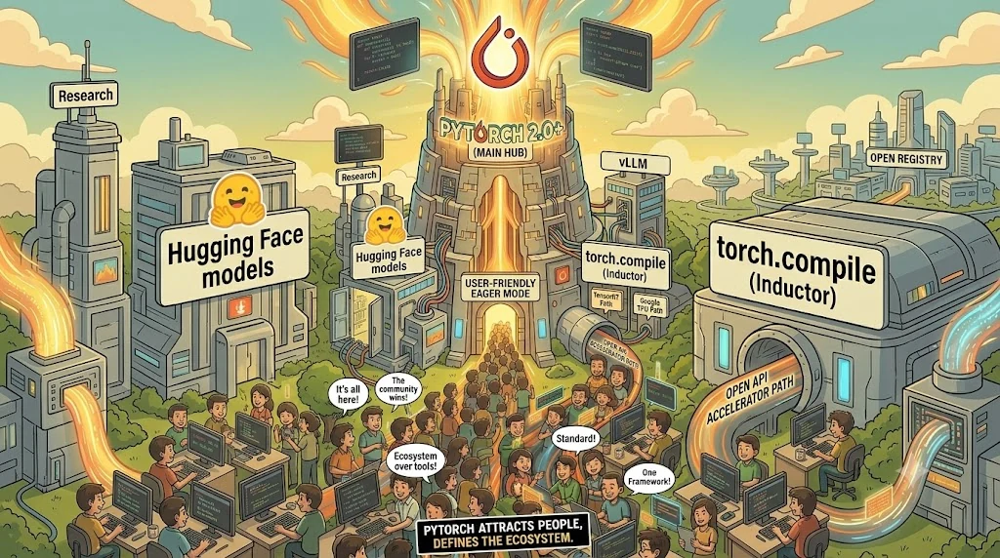

### 개요

안녕하세요? HyperAccel CL(Compute Library)팀 박현준입니다. [1편]()에서는 `torch.compile()` 을 TorchDynamo, AOTAutograd, TorchInductor(이하 Dynamo, Inductor) 세 요소로 나누어 살펴봤습니다. Dynamo는 파이썬 코드에서 그래프를 꺼내고, AOTAutograd는 그 그래프를 정리하고, Inductor는 정리된 그래프로 커널을 만듭니다. (그래프라는 개념에 대해서는 1편에서 다뤘으니 참고 부탁드립니다.)

이번 편에서는 왜 PyTorch는 이를 굳이 세 단계로 나누었을지에 대한 의문에서 시작합니다. 세 단계로 나누었을 때 얻을 수 있는 이득은 무엇이고 누구를 위한 것인지를 이야기해보고자 합니다.

저는 이 질문에 대해 기술적으로 모듈화하기 위함이라는 측면도 있지만, 생태계 확장성 측면으로도 정답이 있다고 생각합니다. 그래서 먼저 PyTorch가 어떻게 사람을 모아 생태계를 만들었는지, 그리고 2.0 이후 그 생태계를 어느 방향으로 넓히고 있는지 살펴봅니다. 그 이후 세 단계가 각각 어떤 결과물을 내놓고 그 결과물을 누가 어떻게 쓰는지 정리한 뒤, 이 구조를 가장 많이 쓰는 회사들의 사례로 마무리하겠습니다.

이 시리즈는 3편까지 이어집니다. 참고로 제가 다음 주에 PyTorch Conference 2026에 참관할 예정인데, 다녀와서 알게 된 최신 동향 및 느낀 점은 다음 편에서 정리해 보겠습니다.

---

## Part 1. 생태계로 자란 PyTorch {#part1}

### 소프트웨어는 결국 생태계 싸움

메신저를 하나 떠올려 보겠습니다. 처음 메신저를 고를 때 우리가 보는 것은 기능보다 **친구들이 어디에 있느냐** 입니다. 기능이 더 좋은 신규 메신저가 출시되더라도 우리는 결국 사람이 더 많은 기존 메신저를 벗어나지 못합니다.

그런데 사람이 많이 모인 메신저에는 기능도 따라붙습니다. 선물하기, 송금, 예약처럼 사람이 많아야 의미가 있는 기능이 생기고, 그 기능을 보고 또 사람이 모입니다. 사람이 모이면 기능이 생기고, 기능이 생기면 사람이 더 모입니다. 이 순환이 한 번 돌기 시작하면 다른 메신저들은 점점 더 이기기 어려워집니다.

딥러닝 프레임워크도 마찬가지입니다. 사용자 입장에서는 예제와 질문에 대한 답, 공개된 모델이 많은 프레임워크를 고르는 것이 합리적입니다. 막혔을 때 검색 한 번으로 풀리는 환경은 그 자체로 생산성이니까요. 라이브러리나 도구를 만드는 개발자도 같습니다. 사용자가 많은 프레임워크 위에 만들어야 자기 결과물이 쓰입니다. 양쪽 모두에게 **"많이 쓰는 쪽"을 고르는 것이 가장 합리적인 선택** 입니다.



### 사람을 모은 PyTorch

이러한 생태계를 가장 잘 구축한 프레임워크가 PyTorch입니다. PyTorch가 처음 공개된 2017년 무렵, 대표 프레임워크는 TensorFlow였습니다. 당시 TensorFlow 1.x에서는 코드를 써도 바로 계산되지 않았습니다. `y = x * 2 + 1` 같은 코드는 계산이 아니라 "나중에 이렇게 계산하라"는 그래프를 만드는 코드였고, 실제 계산은 세션을 열어 실행해야 일어났습니다. 그래서 `print(y)` 를 해도 값 대신 그래프 정보가 나왔습니다. 파이썬의 `if` 문 대신 그래프 전용 문법을 따로 배워야 했고, 에러가 나도 어느 줄이 문제인지 찾기 어려웠습니다. 반면 PyTorch에서는 같은 코드가 바로 계산됩니다.

```python
# PyTorch
x = torch.tensor(3.0)
y = x * 2 + 1
print(y)    # tensor(7.)
```

PyTorch는 그냥 파이썬처럼 쓸 수 있었습니다. 한 줄씩 실행되면서 바로 계산되니, `print` 로 중간 값을 확인하고 에러가 나면 그 줄을 바로 고칠 수 있었습니다. 새 아이디어를 빠르게 시험해야 하는 연구자들이 먼저 PyTorch로 넘어왔고, TensorFlow도 2.0(2019)부터 같은 방식을 기본으로 바꿨습니다.

그 편함에 개발자들이 먼저 모였고, 개발자가 모이자 기능도 늘어났습니다. Hugging Face 같은 모델 허브와 vLLM, SGLang 같은 추론 엔진도 PyTorch 위에 만들어지고, 개발자는 점점 더 PyTorch의 대체제를 찾기 어려워졌습니다.

### torch.compile이 지켜야 했던 것

2023년 3월, PyTorch 2.0과 함께 `torch.compile()` 이 나왔습니다. 이는 파이썬처럼 쓰는 편함은 그대로 두면서 성능을 끌어올리려는 시도였습니다.

이 시점의 PyTorch는 이미 거대한 생태계였습니다. 사용자 코드만 많은 게 아니라, PyTorch 모델을 받아 자기 방식으로 최적화하는 도구들도 자리 잡고 있었습니다. NVIDIA의 TensorRT는 PyTorch 모델을 추론 엔진으로 바꿔 빠르게 돌렸고, Google의 PyTorch/XLA는 PyTorch 코드를 TPU에서 돌리는 통로였습니다.

저는 새 컴파일러가 이 생태계를 깨지 않으려면 두 가지를 지켜야 한다고 생각합니다. 첫째, 사용자는 코드를 거의 고치지 않아야 합니다. 둘째, 이런 도구들이 `torch.compile()` 과 함께 사용할 수 있어야 합니다. 만약 `torch.compile()` 이 PyTorch의 컴파일러와 Triton에만 쓰이는 닫힌 구조였다면, 사용자는 `torch.compile()` 과 기존에 사용하던 도구 중 하나를 골라야 했을 것이고 생태계는 갈라졌을 겁니다.


### 방향은 바깥으로

출시 당시 Inductor가 만들 수 있는 코드는 GPU용 Triton과 CPU용 C++ 두 가지였습니다. 그 뒤의 릴리스를 보면 새로 들어온 기능의 상당수가 **PyTorch 바깥의 컴파일러와 하드웨어가 끼어들 경로** 를 뚫는 작업입니다. 새 디바이스용 코드 생성기 등록(2.1), 파이썬 커스텀 연산(2.4), 디바이스 확장 자동 로드와 Intel GPU 지원(2.5), 디바이스 공용 API인 `torch.accelerator`(2.6), 가속기 통합 공식 문서(2.9)가 그 예입니다.

PyTorch는 모든 것을 직접 만드는 대신 **외부 컴파일러와 하드웨어가 들어올 경로를 늘리는 쪽** 으로 움직이고 있습니다. 버전이 오를 때마다 외부 모듈을 연결하는 공개 API와 문서가 하나씩 늘어나고 있습니다. 이런 경로가 `torch.compile()` 안에서 가능한 것은 애초에 `torch.compile()` 이 세 단계로 나뉘어 있기 때문입니다. Part 2에서 그 이유를 살펴보겠습니다.

---

## Part 2. 왜 세 단계로 나눴을까 {#part2}

### 한 덩어리였다면

반대로 `torch.compile()` 이 파이썬 코드를 받아 Triton 코드를 내놓는 한 덩어리 컴파일러였다고 상상해 보겠습니다. TensorRT 같은 다른 컴파일러를 쓰고 싶은 팀은, 바이트코드를 해석하고 guard를 세우는 그래프 캡처부터 직접 해야 합니다. 새로운 하드웨어를 붙이려는 회사는 그래프 캡처부터 코드 생성까지 전부 다시 만들어야 합니다. 반대로 PyTorch가 그래프 캡처를 개선해도 그 혜택을 외부 유저가 받을 수 없습니다.

하지만 세 단계로 나누고 각 단계를 **정해진 형식의 데이터** 로 이어 두면 이야기가 달라집니다. 어떤 형식이 필요한 쪽은 그 단계의 출력을 받아 가면 되고, 한 단계만 바꾸고 싶은 쪽은 나머지 단계를 그대로 쓰면 됩니다. 필요한 곳까지는 `torch.compile()` 을 그대로 쓰다가, 원하는 단계에서 갈라져 나와 자기 도구를 붙이면 됩니다.


이 글에서는 세 단계를 각자 하는 일의 이름으로 부르겠습니다. 순서는 1편에서 본 세 요소와 같습니다.

- **1단계 그래프 캡처(Graph Capture)**: Dynamo가 파이썬 코드에서 그래프를 뽑아냅니다.
- **2단계 그래프 정규화(Graph Normalization)**: AOTAutograd가 그 그래프를 core ATen 연산으로 다듬습니다.
- **3단계 코드 생성(Code Generation)**: Inductor가 연산을 묶은 뒤 커널 코드를 적습니다.

### 1단계 그래프 캡처: 그래프가 필요한 쪽에게

Dynamo가 내놓는 것은 FX 그래프와 guard입니다. 파이썬 코드에서 그래프를 뽑아내는 일은 까다롭지만, Dynamo가 이 일을 대신 해 주기 때문에 다른 도구는 그 결과만 받아 쓰면 됩니다.

Dynamo의 출력을 가장 많이 받아 쓰는 쪽은 **다른 컴파일러** 입니다. NVIDIA의 TensorRT(`backend="torch_tensorrt"`), Intel의 OpenVINO(`backend="openvino"`), Google의 XLA(`backend="openxla"`)처럼, 그래프를 받아 최적화부터 커널 생성까지 통째로 해내는 별도의 컴파일러입니다. `backend` 자리에 이름만 넘기면 AOTAutograd와 Inductor가 하던 일을 이 컴파일러가 자기 방식으로 대신합니다. 연산을 어떻게 묶을지부터 스스로 정한다는 점에서, 코드를 적는 부분만 바꾸는 코드 생성 단계와 다릅니다.

이들이 Inductor 대신 쓰이는 이유는 `torch.compile()` 보다 먼저 있었고, 각자 하드웨어에 맞춰 오래 다듬어진 독립 도구이기 때문입니다. TensorRT는 NVIDIA GPU 추론, OpenVINO는 Intel CPU와 GPU, XLA는 Triton이 돌지 않는 TPU에 맞춰져 있습니다. 이미 잘 만든 컴파일러를 다시 만들기보다 그래프만 넘겨받아 쓰는 편이 자연스럽고, 사용자는 문자열 하나만 바꾸면 됩니다.

직접 확인해 보겠습니다. `backend` 자리에 받은 그래프를 출력만 하는 함수를 넘겨 봅니다.

```python
import torch
import torch.nn.functional as F


def show_graph(gm, example_inputs):
    print(gm.code)      # 백엔드가 받은 그래프를 출력
    return gm.forward   # 실행은 그대로


def f(x, w, b):
    return F.relu(F.linear(x, w, b))


x, w, b = torch.randn(2, 16), torch.randn(16, 16), torch.randn(16)
torch.compile(f, backend=show_graph)(x, w, b)
```

출력에서 핵심 줄만 옮기면 다음과 같습니다(PyTorch 2.10).

```text
linear = torch._C._nn.linear(l_x_, l_w_, l_b_)
relu = torch.nn.functional.relu(linear)
```

사용자가 쓴 `F.linear` 와 `F.relu` 가 그대로 그래프가 되어 넘어왔습니다. 받는 쪽은 파이썬을 해석할 필요 없이 이 연산들만 처리하면 됩니다.

### 2단계 그래프 정규화: 줄어든 연산

같은 함수를 이번에는 AOTAutograd를 거친 뒤에 받아 보겠습니다. 앞의 `show_graph` 를 `aot_autograd` 로 한 번 감싸기만 하면 됩니다.

```python
from torch._dynamo.backends.common import aot_autograd
from torch._decomp import core_aten_decompositions

aten_backend = aot_autograd(fw_compiler=show_graph, decompositions=core_aten_decompositions())
torch.compile(f, backend=aten_backend)(x, w, b)
```

```text
permute = torch.ops.aten.permute.default(arg1_1, [1, 0])
addmm = torch.ops.aten.addmm.default(arg2_1, arg0_1, permute)
relu = torch.ops.aten.relu.default(addmm)
```

`linear` 가 전치(`permute`)와 행렬 곱 덧셈(`addmm`)으로 풀렸고, 모든 연산이 PyTorch의 기본 연산 모음인 **core ATen** 의 이름으로 바뀌었습니다. 1편에서 본 decomposition의 결과입니다.

이 단계를 거친 그래프의 가치는 숫자로 보면 분명합니다. PyTorch에는 연산이 오버로드까지 2,500개가 넘게 있지만(2.14 기준), core ATen은 약 190개입니다. 이 그래프를 받으면 2,500여 개가 아니라 **약 190개 연산만 처리하면 됩니다.** 그래서 자체 그래프 컴파일러를 가진 쪽은 보통 여기서 그래프를 받습니다.

### 3단계 코드 생성: 코드를 적는 부분만 바꾸기

마지막은 Inductor가 맡는 코드 생성 단계입니다. 이름은 코드 생성이지만, Inductor는 코드를 적기 전에 연산을 어떻게 묶을지부터 정합니다. 예를 들어 `y = x * 2 + 1` 을 컴파일한다고 해 보겠습니다. Inductor는 먼저 이 계산을 원소 하나 기준의 식 `y[i] = x[i] * 2 + 1` 로 바꿉니다. 곱셈과 덧셈을 커널 하나로 묶는 것, 즉 융합도 이 단계에서 끝납니다. 이 식을 **어떤 언어로 적을지** 는 맨 마지막에 정합니다.

GPU용으로 적으면 Triton 코드가 됩니다(핵심 줄만 옮겼습니다).

```python
tmp0 = tl.load(in_ptr0 + x0)      # x[i] 읽기
tmp2 = tmp0 * 2.0                 # * 2
tmp4 = tmp2 + 1.0                 # + 1
tl.store(out_ptr0 + x0, tmp4)     # y[i] 쓰기
```

CPU용으로 적으면 같은 식이 C++ 코드가 됩니다. 실제로 PyTorch 2.10 CPU에서 뽑은 코드를 줄이면 다음과 같습니다.

```cpp
auto tmp0 = Vectorized<float>::loadu(in_ptr0 + x0);  // x[i] 읽기
auto tmp3 = tmp0 * Vectorized<float>(2.0);           // * 2
auto tmp6 = tmp3 + Vectorized<float>(1.0);           // + 1
tmp6.store(out_ptr0 + x0);                           // y[i] 쓰기
```

두 코드는 같은 계산을 다른 언어로 적었을 뿐입니다. 읽고, 곱하고, 더하고, 쓰는 순서는 Inductor가 이미 정해 두었습니다. 이 단계를 활용하는 쪽은 바로 이 **"적는 부분"** 만 자기 것으로 바꿉니다. 

다만 Inductor가 정하는 묶는 방식은 GPU와 CPU를 기준으로 만들어졌고, 이 등록 API도 아직 private입니다. 연산을 묶는 방식부터 칩에 맞게 정해야 한다면 정규화된 그래프를 받아 직접 컴파일하는 편이 낫습니다.

### 컴파일되지 않는 부분: 폴백과 PrivateUse1

`torch.compile()` 이 모든 코드를 컴파일하지는 못합니다. graph break로 끊긴 구간이나 컴파일러가 지원하지 않는 연산은 컴파일하지 않고 원래대로 한 줄씩 바로 실행되는데, 이를 **폴백(fallback)** 이라고 부릅니다. 새 하드웨어가 제대로 쓰이려면 이 폴백도 그 하드웨어 위에서 실행할 수 있어야 합니다.

폴백은 PrivateUse1이 해결합니다. 1편에서 본 디스패처는 텐서가 어느 디바이스에 있는지 보고 커널을 고르는데, PyTorch는 본체 밖 디바이스를 위해 **PrivateUse1** 이라는 디스패치 키를 비워 두었습니다. `torch.utils.rename_privateuse1_backend("npu")` 로 이름을 붙이고 ATen 연산마다 커널을 등록하면, 폴백된 연산도 그 디바이스에서 실행됩니다. `tensor.to("npu")` 와 `torch.accelerator`, autograd도 함께 쓸 수 있게 됩니다.

ATen에 없는 연산은 `torch.library.custom_op` 으로 정의합니다. 출력의 모양과 타입만 알려 주는 fake 구현을 함께 등록하면, Dynamo가 이 연산을 **하나의 노드로 그래프에 담기 때문에**, 한 줄씩 실행할 때도 컴파일할 때도 그대로 쓰입니다.

### 한눈에 보기

| 단계 | 넘겨주는 것 | 받아 쓰는 쪽 | 얻는 것 |
| --- | --- | --- | --- |
| **1단계 그래프 캡처** (Dynamo) | 사용자가 쓴 연산 그대로의 그래프 | TensorRT, OpenVINO, XLA 같은 컴파일러 백엔드, `torch.export` | 파이썬 코드를 해석하는 일을 하지 않아도 됨 |
| **2단계 그래프 정규화** (AOTAutograd) | core ATen 연산만 남은 그래프 | 자체 그래프 컴파일러를 가진 백엔드 | 처리할 연산이 2,500여 개에서 약 190개로 줄어듦 |
| **3단계 코드 생성** (Inductor) | 연산 묶기가 끝난 원소 단위 식 | Triton을 지원하는 GPU, 코드 생성기를 바꾸는 새 칩 | 코드를 "적는 부분" 만 만들면 됨 |
| **폴백: 디스패처** | 컴파일되지 않은 연산 하나(바로 실행) | 모든 디바이스 | 컴파일되지 않는 부분도 그 디바이스에서 실행 |


---

## Part 3. GPU가 아닌 칩은 이 구조를 어떻게 쓰는가 {#part3}

이 구조를 가장 넓게 쓰는 쪽은 GPU가 아닌 AI 칩, 흔히 **Neural Processing Unit(NPU)** 이라고 부르는 칩을 만드는 회사들입니다. Triton이 그대로 맞지 않는 경우가 많아 그래프 정규화나 코드 생성 단계로 직접 들어와야 하고, 폴백도 스스로 처리해야 하기 때문입니다. Part 3에서는 torch.compile()을 적극적으로 사용하는 세 회사를 간단히 살펴보겠습니다.

### Huawei Ascend: 정규화된 그래프와 코드 생성 모두

Huawei의 Ascend는 **그래프 정규화와 코드 생성 단계를 모두** 활용합니다. 먼저 TorchAir라는 백엔드가 정규화된 그래프를 받아 Ascend의 자체 그래프 엔진에 넘깁니다. 그리고 코드 생성 단계에서는 Inductor에 Ascend용 코드 생성기를 등록합니다. 디바이스는 PrivateUse1에 `npu` 라는 이름을 붙여 연결했습니다. 정리하면 TorchAir 경로는 Dynamo와 AOTAutograd까지 재사용하고 Inductor를 자체 그래프 엔진으로 대체했습니다. Inductor 경로는 Inductor의 연산 묶기까지 재사용하고 코드를 적는 부분만 Ascend용으로 대체했습니다.

### Intel Gaudi: 정규화된 그래프를 받아 자체 컴파일러로

Intel Gaudi는 **정규화된 그래프** 를 받아 씁니다. `hpu_backend` 라는 백엔드가 이 그래프를 받아 Gaudi의 자체 그래프 컴파일러에 넘기고, Inductor는 거치지 않습니다. 디바이스 `hpu` 는 PrivateUse1이 아니라 PyTorch 본체에 들어 있는 디바이스 타입입니다. 정리하면 Dynamo와 AOTAutograd까지 재사용하고, Inductor 전체를 자체 그래프 컴파일러로 대체했습니다.

### IBM Spyre: 코드 생성기만 바꾸기

IBM의 Spyre는 **코드 생성 단계** 를 활용합니다. Inductor에 Spyre용 코드 생성기를 등록해, Inductor가 묶어 준 계산을 Spyre용 코드로 적고 마지막 변환은 자체 컴파일러가 맡습니다. 디바이스는 PrivateUse1에 `spyre` 라는 이름을 붙였습니다. 예전에는 Inductor를 거치지 않는 방식을 썼는데, [발표 소개](https://pytorchconferenceeu2026.sched.com/event/2Hiqa)에 따르면 코드 생성 단계를 활용하는 방식으로 옮기며 자체 컴파일러 코드를 상당 부분 줄일 수 있었다고 합니다. 정리하면 Dynamo, AOTAutograd, Inductor의 연산 묶기까지 재사용하고, 코드를 적는 부분과 그 뒤의 최종 변환만 자체 모듈로 대체했습니다.

### 한눈에 비교하기

| | 활용한 단계 | 연결 방식 | 디바이스 |
| --- | --- | --- | --- |
| **Huawei Ascend** | 그래프 정규화 + 코드 생성 | 정규화: TorchAir → 자체 그래프 엔진 / 코드 생성: Inductor에 코드 생성기 등록 | PrivateUse1 `npu` |
| **Intel Gaudi** | 그래프 정규화 | `hpu_backend` → 자체 그래프 컴파일러 | 본체 내장 `hpu` |
| **IBM Spyre** | 코드 생성 | Inductor에 코드 생성기 등록 → 자체 컴파일러 | PrivateUse1 `spyre` |

세 회사 모두 Dynamo의 그래프 캡처는 그대로 쓰고, 폴백도 자기 디바이스에서 처리하도록 갖췄습니다. 갈린 곳은 그래프 정규화와 코드 생성 중 어느 단계에서 들어오느냐, 즉 **"하드웨어에 맞는 결정을 어디까지 Inductor에 맡길 것인가"** 입니다. 많이 맡길수록 만들 것이 줄고, 적게 맡길수록 하드웨어에 맞는 결정을 직접 내릴 수 있습니다.

참고로 저희 HyperAccel의 LPU는 Gaudi처럼 정규화된 그래프를 받아, 자체 언어인 [Legato]()로 커널을 만듭니다. 자세한 내용은 [Legato 문서](https://legato-docs.hyperaccel.net/latest/)에서 확인하실 수 있습니다.

---

## Conclusion

처음 질문으로 돌아가 보겠습니다. `torch.compile()` 은 왜 세 단계로 나뉘어 있을까요? 저는 이유가 두 가지라고 봅니다.

첫째는 기술적인 이유입니다. 파이썬 코드에서 그래프를 꺼내는 일(Dynamo), 그래프를 표준 연산으로 정리하는 일(AOTAutograd), 하드웨어용 코드를 만드는 일(Inductor)은 성격이 전혀 다른 일입니다. 이 일들을 나눠 두면 각각을 따로 발전시키기 쉽고, 다른 도구가 중간 결과를 가져다 쓰기도 편합니다.

둘째는 생태계를 위한 이유입니다. PyTorch는 파이썬처럼 쉽게 쓸 수 있는 방식으로 연구자와 개발자를 모았고, 그 위에 모델과 도구가 쌓이며 사실상의 표준이 되었습니다. 다음 과제였던 속도를 위해 `torch.compile()` 을 만들면서, PyTorch는 각 단계의 출력을 외부 컴파일러와 하드웨어가 받아 쓸 수 있도록 설계했습니다. PyTorch 2.0 공식 소개에도 백엔드(컴파일러)를 붙이는 경험을 단순하게 만들겠다는 목표와, 연산 수를 줄여 벤더가 통합을 쉽게 하도록 돕겠다는 설명이 나옵니다. 그래프 캡처의 출력은 TensorRT 같은 다른 컴파일러가, 그래프 정규화의 출력은 자체 그래프 컴파일러를 가진 쪽이 받아 씁니다. 코드 생성 단계에는 새로운 하드웨어가 들어오고, 컴파일되지 않는 부분은 PrivateUse1이 받아 줍니다.

실제로 이 길로 벤더들이 몰려들고 있습니다. Part 3에서 본 것처럼 GPU가 아닌 가속기, 특히 NPU를 만드는 회사들이 각자 필요한 단계로 들어오고 있고, PyTorch도 버전마다 그 길을 공식 API와 문서로 다져 가고 있습니다. 이것을 PyTorch가 처음부터 짜 둔 전략이라고 단정할 수는 없습니다. 다만 메신저로 치면 사람이 충분히 모인 플랫폼이 바깥에 길을 열어 두었고, 그 길로 새로운 참여자가 몰려오며 생태계가 GPU 너머로 넓어지고 있다고 저는 생각합니다.

다음 편에서는 시야를 조금 넓혀, 10월 20~21일 미국 산호세에서 열리는 PyTorch Conference 2026을 다녀와서 느낀 점을 정리해보고자 합니다. 긴 글 읽어주셔서 감사합니다.

## Reference

**PyTorch 공식 문서와 블로그**

- [PyTorch 2.0 release blog](https://pytorch.org/blog/pytorch-2.0-release/) — `torch.compile()` 출시
- [PyTorch 2.0 소개](https://docs.pytorch.org/get-started/pytorch-2.0/) — 백엔드 통합을 단순하게 만들겠다는 설계 의도
- [Custom Backends](https://docs.pytorch.org/docs/main/user_guide/torch_compiler/torch.compiler_custom_backends.html) — 그래프 캡처·정규화 단계의 출력에 백엔드를 붙이는 방법
- [Accelerator Integration](https://docs.pytorch.org/docs/2.9/accelerator/index.html) — PrivateUse1 기반 가속기 통합 가이드
- [Intel GPU Support Now Available in PyTorch 2.5](https://pytorch.org/blog/intel-gpu-support-pytorch-2-5/)
- [PyTorch 2.9 Release Blog](https://pytorch.org/blog/pytorch-2-9/) — LibTorch Stable ABI
- [PyTorch v2.13.0 Release Notes](https://github.com/pytorch/pytorch/releases/tag/v2.13.0) — `torch.compiler.set_default_backend`

**각 단계를 활용하는 컴파일러와 하드웨어**

- [Ascend Extension for PyTorch (torch_npu)](https://github.com/Ascend/pytorch), [TorchAir](https://github.com/Ascend/torchair), [Triton-Ascend](https://github.com/Ascend/triton-ascend)
- [Intel Gaudi PyTorch Theory of Operations](https://docs.habana.ai/en/latest/PyTorch/PyTorch_Gaudi_Theory_of_Operations.html), [Gaudi PyTorch Support Matrix](https://docs.habana.ai/en/latest/PyTorch/Reference/PyTorch_Support_Matrix.html), [Gaudi PyTorch Bridge](https://github.com/HabanaAI/gaudi-pytorch-bridge)
- [torch-spyre](https://github.com/torch-spyre/torch-spyre), [torch-spyre 컴파일러 아키텍처](https://torch-spyre.readthedocs.io/en/latest/compiler/architecture.html), [IBM Research: PyTorch support for IBM Spyre](https://research.ibm.com/blog/pytorch-support-ibm-spyre), [PyTorch Conference Europe 2026 발표](https://pytorchconferenceeu2026.sched.com/event/2Hiqa)

**HyperAccel**

- [Legato 문서](https://legato-docs.hyperaccel.net/latest/)
- [Legato: HyperAccel LPU를 위한 프로그래밍 언어]()

## 추신: HyperAccel은 채용 중입니다!


HyperAccel은 LPU라는 새로운 칩을 만드는 회사이지만, 동시에 소프트웨어의 최신 흐름을 가장 가까이에서 따라가며 개발하는 팀이기도 합니다. 이번 글에서 다룬 `torch.compile()` 처럼 새로운 하드웨어를 둘러싼 소프트웨어 스택은 지금도 빠르게 바뀌고 있고, 저희는 그 최전방에서 일하고 있습니다.

사용자가 새로운 디바이스를 기존 방식 그대로, 편하게 사용할 수 있도록 만드는 연구와 개발에 함께하고 싶으시다면 [HyperAccel Career](https://hyperaccel.career.greetinghr.com/ko/guide)로 지원해 주세요!
