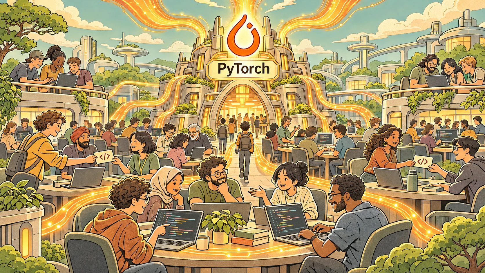
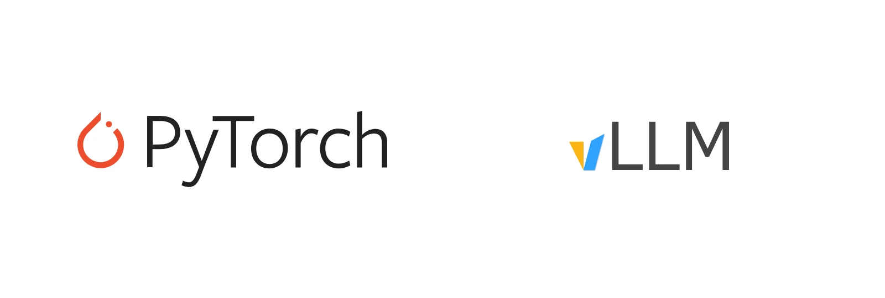
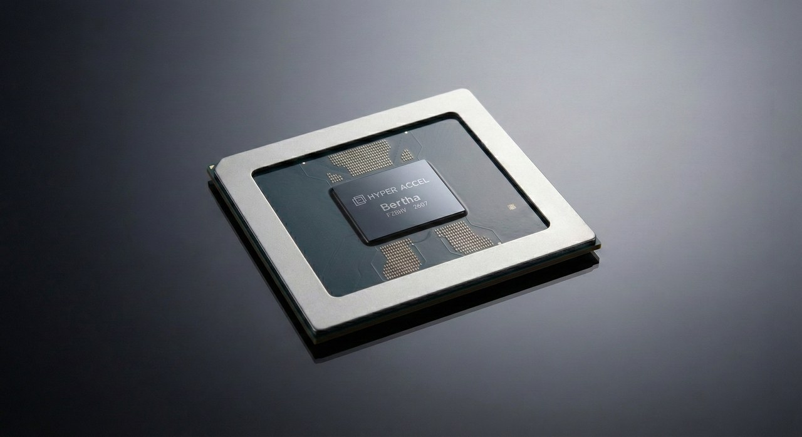

<!-- b:torch-compile-anatomy-3-1 -->
## Overview

<!-- b:torch-compile-anatomy-3-2 -->
Hello, this is Hyunjun Park from the CL (Compute Library) team at HyperAccel. In [Part 1](https://hyper-accel.github.io/en/posts/torch-compile-anatomy/), we looked at how `torch.compile()` works. In [Part 2](https://hyper-accel.github.io/en/posts/torch-compile-anatomy-2/), we explored why it is split into three stages and who makes use of that structure. Those two posts laid the groundwork for this one. Here, I will share the research and development trends I saw at PyTorch Conference 2026, held October 20–21 in San Jose.

<!-- b:torch-compile-anatomy-3-3 -->
After the conference, I asked an agent about its main research themes. It named training, inference, PyTorch core modules, and kernel optimization. I mainly attended inference, compiler, and accelerator sessions. This post is therefore **my interpretation of the trends in the sessions I chose**, rather than a summary of the entire conference. Where I did not attend a session, I use its public description and mark that explicitly.

I grouped the recurring themes into three keywords: **Agent**, **Acceleration**, and **Ecosystem**. The post follows those three themes.

<!-- b:torch-compile-anatomy-3-5 -->
1. As agents speed up development, how are projects changing their **Continuous Integration (CI)** and code structure?
2. What are PyTorch and vLLM making faster?
3. What tools are **Neural Processing Unit (NPU)** companies building to join the PyTorch ecosystem?

<!-- b:torch-compile-anatomy-3-6 -->
---

<!-- b:torch-compile-anatomy-3-7 -->
## Part 1. Agent: keeping up with faster development {#part1}

<!-- b:torch-compile-anatomy-3-8 -->
### The bottleneck moves to review

<!-- b:torch-compile-anatomy-3-9 -->
In the vLLM Roadmap session I attended, **project management** stood out as much as the new features. With commits and contributors growing rapidly, the project has been changing its release and maintenance processes. Comparing the **pull requests (PRs)** created on GitHub each October shows the scale of that growth.

<!-- b:torch-compile-anatomy-3-10 -->
| Repository | Oct 2024 | Oct 2025 | Oct 2026 |
| --- | ---: | ---: | ---: |
| vllm-project/vllm | 453 | 1,323 | 4,577 |
| pytorch/pytorch | 1,711 | 1,900 | 2,887 |

<!-- b:torch-compile-anatomy-3-11 -->
*Based on GitHub search; includes PRs opened by bots. Retrieved November 4, 2026.*

<!-- b:torch-compile-anatomy-3-12 -->
The number of vLLM PRs grew roughly tenfold in two years. These figures also reflect the project’s own growth, so the increase cannot be attributed entirely to agents. Still, the burden of reviewing and maintaining a growing volume of contributions was increasing. The description of PyTorch’s [Fighting Agents with Agents](https://pytorch.org/blog/core-pytorch-sessions-at-pytorch-conference-north-america-2026/) session likewise opens with the growing number of agent-written PRs that maintainers need to review.

<!-- b:torch-compile-anatomy-3-13 -->
As writing code becomes cheaper, **reading, validating, and maintaining it** becomes more important. Projects have started by clarifying the rules for contributors. The [vLLM contributing guide](https://docs.vllm.ai/en/v0.28.0/contributing/) says not to submit "pure agent" PRs. The person submitting a change is responsible for reviewing every changed line and validating its behavior end to end.

<!-- b:torch-compile-anatomy-3-14 -->
### CI: fighting agents with agents

<!-- b:torch-compile-anatomy-3-15 -->
Alongside these rules, CI and review processes are changing too. I did not attend the sessions in this section, so this account is based on their public descriptions.

<!-- b:torch-compile-anatomy-3-16 -->
- **Fighting Agents with Agents: Bringing Claude to PyTorch CI, triage, and PR review:** PyTorch added automatic issue triage, PR review skills, and CI and autorevert investigation to its infrastructure. The stated goal is to support maintainers, not replace them.
- **Shipping PyTorch and Its Ecosystem: A Modern Release Story:** Triton and vLLM are continuously validated against PyTorch nightlies, so breakage surfaces before the release branch is cut. Agents triage CI failures and draft fixes, but people make the final call.

<!-- b:torch-compile-anatomy-3-17 -->
What stood out in both sessions was the division of responsibilities between people and agents. Agents handle repetitive work such as triage, investigation, and drafting fixes, while **people make the final decisions**. vLLM also manages its limited CI resources by not starting CI automatically on every new commit. Reviewers, or the author of an approved PR, trigger it with `/ci run`.

<!-- b:torch-compile-anatomy-3-18 -->
### Refactoring: a structure more people can contribute to

<!-- b:torch-compile-anatomy-3-19 -->
Code structure becomes more important as the contributor base grows. When many people change the same areas, review gets harder and changes are more likely to conflict. vLLM presented refactoring that separates shared behavior from the parts that vary by backend.

<!-- b:torch-compile-anatomy-3-20 -->
[A Developer's Guide to Attention in vLLM](https://events.linuxfoundation.org/pytorch-conference-north-america/program/schedule/?id=1254038) is a good example. Each kind of attention has different metadata and a different **key-value (KV)** cache layout, so branches kept growing in the backend and connector code. vLLM now builds common metadata (`CommonAttentionMetadata`) once per step, and each backend adds only what it needs. The logical dimension order of the KV cache is standardized, and the actual memory layout is expressed through strides. Separating logical shape from physical layout means fewer places to change when adding a new attention type or storage scheme.

<!-- b:torch-compile-anatomy-3-21 -->
Flat Model and Model Runner V2 from the roadmap are model-execution reworks in the same direction. Going by its public description, [One Model Definition, Many Accelerators](https://pytorch.org/blog/vllm-sessions-at-pytorch-conference-north-america-2026/) separates model logic from hardware execution paths, so the same definition runs on Intel Gaudi and IBM Spyre without platform-specific code.

<!-- b:torch-compile-anatomy-3-22 -->
The talks mainly explained this work as making new models and architectures easier to support. Refactoring helps maintenance regardless of the rise of agents. My own thought was that the falling cost of changing code might also play a role. Structural improvements that were recognized as necessary but postponed because of their cost may now be easier to attempt with help from agents. This is my interpretation after hearing several sessions, rather than an explanation given by the speakers.

<!-- b:torch-compile-anatomy-3-23 -->
---

<!-- b:torch-compile-anatomy-3-24 -->
## Part 2. Acceleration: what PyTorch and vLLM are speeding up {#part2}

<!-- b:torch-compile-anatomy-3-25 -->
If Part 1 was about development speed, Part 2 is about the time spent from compilation through serving. The sessions I attended emphasized not only **the speed of generated code**, but also reducing compilation costs and waiting time at runtime.

<!-- b:torch-compile-anatomy-3-26 -->
### Faster compilation: FakeTensor and graph breaks

<!-- b:torch-compile-anatomy-3-27 -->
Let's start with [Speeding Up torch.compile: A New FakeTensor](https://events.linuxfoundation.org/pytorch-conference-north-america/program/schedule/?id=1257046). FakeTensor is a tensor with no real data that computes only metadata such as shape, dtype, and device. Dynamo does this for every op while tracing, and Inductor uses it during code generation too. According to the session description, this propagation accounts for about 20% of Dynamo tracing time.

<!-- b:torch-compile-anatomy-3-28 -->
The approach is to reimplement FakeTensor in C++. Reducing the overhead of Python dispatch and symbolic operations brought the geometric mean execution time across 118 operations down from 48.2 µs to 2.2 µs. The reported speedup was **22.3x**. These are per-operation measurements, however. The end-to-end torchbench compilation metric improved by 3.7–11.6% depending on the configuration, with individual models improving by as much as 20–30%.

I was impressed by how much improvement came from changing the implementation path. The future work of porting the remaining Python meta kernels to C++ also came with a plan on the slide: "Use Agents!" The use of agents we saw in Part 1 appeared here as well.

<!-- b:torch-compile-anatomy-3-29 -->
Graph-break handling is improving too. In Part 1 of this series, I explained that graph breaks shorten graphs and limit opportunities for fusion. Deeply nested function calls also create duplicate work. According to the [Nested Graph Breaks](https://pytorch.org/blog/core-pytorch-sessions-at-pytorch-conference-north-america-2026/) session description, reducing O(N) duplicate graph breaks to O(1) in calls nested N levels deep allows larger graphs to be captured.

<!-- b:torch-compile-anatomy-3-30 -->
[Lightweight FX Tracing in PyTorch](https://events.linuxfoundation.org/pytorch-conference-north-america/program/schedule/?id=1256183) starts from feedback that Dynamo is too heavy for users who need a full graph. It proposes a lightweight tracing path based on `make_fx` for suitable code, such as tensor computations without Python side effects.

<!-- b:torch-compile-anatomy-3-34 -->
### Faster execution: agent workloads and vLLM

<!-- b:torch-compile-anatomy-3-35 -->
Agents are changing inference workloads as well as development. More requests maintain long contexts across multiple turns of conversation and tool calls. While a request waits for a tool response, its token generation pauses, but the KV state needed for subsequent generation must remain available or recoverable. vLLM presented optimizations for these workloads.

<!-- b:torch-compile-anatomy-3-36 -->
- **Waiting less:** vLLM Roadmap covered removing the CPU synchronization that stalls the GPU, along with kernel fusion and mega-kernels.
- **Checking several tokens at once:** What's New in Inference in October and the enterprise inference session covered speculative decoding as a way to improve responsiveness.
- **Keeping KV longer and cheaper:** [Native Tiered KV Cache Offloading in vLLM](https://events.linuxfoundation.org/pytorch-conference-north-america/program/schedule/?id=1254938) uses CPU memory as a hub. It frees GPU memory first and handles transfers to storage or other nodes asynchronously.

<!-- b:torch-compile-anatomy-3-37 -->
These problems cannot be solved by `torch.compile()` alone. KV offloading, for example, does not make the decode kernel itself faster. It increases cache capacity and reuse at the cost of data transfers, so its effect depends on the workload and memory usage. The TPU mega-kernel demo also explained the need for prefill/decode disaggregation and cache reuse alongside kernel optimization. Across several sessions, I heard the same message: look beyond the speed of an individual kernel to the serving system as a whole.

<!-- b:torch-compile-anatomy-3-40 -->
---

<!-- b:torch-compile-anatomy-3-41 -->
## Part 3. Ecosystem: building hardware support on a shared foundation {#part3}

<!-- b:torch-compile-anatomy-3-42 -->
Part 2 of this series looked at where each accelerator connects to `torch.compile()`. This section is about what comes next. What does it take to achieve performance on new hardware and preserve compatibility as PyTorch evolves? Let’s look at Huawei and IBM Spyre in turn.

<!-- b:torch-compile-anatomy-3-43 -->
### Huawei: integrating through common interfaces and validating compatibility

<!-- b:torch-compile-anatomy-3-44 -->
Huawei’s [Boosting PyTorch’s Heterogeneous Compute Ecosystem](https://events.linuxfoundation.org/pytorch-conference-north-america/program/schedule/?id=1348281) began with the difficulty of integrating NPUs into GPU-centric code. It framed the work as **Integrate, Perform, Verify**. Hardware support needs to go beyond executing operators to include distributed execution, compilation, and testing.

<!-- b:torch-compile-anatomy-3-45 -->
Integration starts with PrivateUse1, which we covered in Part 2. The OpenReg reference implementation shows how to connect a device, while the common device API `torch.accelerator` helps make CUDA-dependent code device-independent. Huawei described connecting FSDP2, DTensor, and communication backends to support distributed training on this foundation.

<!-- b:torch-compile-anatomy-3-46 -->
Once integrated, a backend needs to remain compatible as PyTorch changes. This is where the CI from Part 1 returns. The **Cross-Repository CI Relay (CRCR)** forwards PyTorch PR events to external repositories, allowing compatibility with out-of-tree backends to be validated before merge. According to the [public session description](https://pytorch.org/blog/core-pytorch-sessions-at-pytorch-conference-north-america-2026/), Huawei combines CRCR with device-agnostic test reuse. It reports using more than 580,000 community tests and delivering stable releases within 30 days of upstream updates.

<!-- b:torch-compile-anatomy-3-47 -->
The talk ended with a call for contributors to help build the NPU ecosystem. What impressed me was the intention to use PyTorch’s interfaces while contributing to integration and validation infrastructure that other devices could share.

<!-- b:torch-compile-anatomy-3-48 -->
### IBM Spyre: reusing Inductor and extending it for the hardware

<!-- b:torch-compile-anatomy-3-49 -->
While Huawei illustrated the foundations for integration and validation, IBM Spyre showed how to build performance using a shared compiler. The [Integrating the IBM Spyre Accelerator](https://events.linuxfoundation.org/pytorch-conference-north-america/program/schedule/?id=1256168) talk and [IBM’s official post](https://pytorch.org/blog/extending-inductor-for-the-ibm-spyre-accelerator/) provided a concrete view of the Inductor extension approach introduced in Part 2.

<!-- b:torch-compile-anatomy-3-50 -->
Spyre is a dataflow accelerator with 32 cores, each with its own 2 MB scratchpad. Data moves in 128-byte units called sticks, and work must be divided among cores at compile time. This makes some of Inductor’s GPU-oriented assumptions difficult to apply directly: **tensor layout, scratchpad management, and work assignment across cores**. torch-spyre handles these with custom passes before scheduling, while reusing much of the rest of Inductor.

<!-- b:torch-compile-anatomy-3-51 -->
By reusing the shared compiler, the roughly 273,000 lines in the previous custom compiler stack became roughly 38,600 lines. **About one-seventh** refers to code size, not execution speed. This reduced the code the team needed to maintain directly and let it concentrate on hardware-specific work. The proposals for [Kernel Tile IR (KTIR)](https://pytorch.org/blog/your-guide-to-hardware-acceleration-compute-infrastructure-at-pytorch-conference-north-america-2026/) and [device-aware tensor layouts](https://pytorch.org/blog/core-pytorch-sessions-at-pytorch-conference-north-america-2026/) also show an effort to bring hardware-required extensions into the shared foundation.

<!-- b:torch-compile-anatomy-3-52 -->
Spyre also uses CRCR. Its approach to selecting tests is particularly interesting. According to the [public post](https://pytorch.org/blog/from-upstream-changes-to-downstream-confidence-inside-torch-spyres-integration-with-pytorch-crcr/), **an agentic pipeline selected the tests relevant to its hardware** from PyTorch’s tens of thousands of tests. The reasons for each selection are recorded in configuration files for people to review, and the classifications are refined using execution logs from real hardware. When moving from PyTorch 2.13 to 2.14, only about 4,000 changed tests needed to be evaluated.

<!-- b:torch-compile-anatomy-3-53 -->
### Common ground: reuse, extend, and validate together

<!-- b:torch-compile-anatomy-3-54 -->
The two examples emphasized different tasks, but their direction was the same: reuse common interfaces and compilers, extend what the hardware needs, and keep validating as upstream evolves. Both also showed an interest in sharing extensions so other devices could benefit.

<!-- b:torch-compile-anatomy-3-56 -->
This is where the three keywords connect. A shared **Ecosystem** supports hardware **Acceleration**, while **Agents** help with the validation needed to keep up with that ecosystem. The division of responsibilities from Part 1—agents making proposals and people exercising judgment—also appears in accelerator support.

<!-- b:torch-compile-anatomy-3-57 -->
---

<!-- b:torch-compile-anatomy-3-58 -->
## Conclusion

<!-- b:torch-compile-anatomy-3-59 -->
At this conference, **Agent** highlighted the importance of validation and maintenance alongside development speed. **Acceleration** extended beyond generated-code performance to compilation costs and runtime waiting time. **Ecosystem** showed accelerator vendors using a shared foundation and seeking to share the extensions they developed to support their hardware.

<!-- b:torch-compile-anatomy-3-60 -->
As a developer at a chip company, I took away two things. First, before building a feature ourselves, we should check whether it already exists or is under development in PyTorch or vLLM. As Spyre demonstrated, reusing a shared foundation can reduce the code we need to maintain directly. I came away thinking that we should actively evaluate open-source modules we could use.

Second, hardware-specific code should have clear boundaries with shared code. As agents make structural improvements easier to attempt, it is worth revisiting modularization work that has been put off. These two days left me thinking about how our software stack could fit more naturally with open-source projects.

<!-- b:torch-compile-anatomy-3-62 -->
## Reference

<!-- b:torch-compile-anatomy-3-63 -->
**Official conference material**

<!-- b:torch-compile-anatomy-3-64 -->
- [PyTorch Conference North America 2026 recap](https://pytorch.org/blog/pytorch-conference-north-america-2026-accelerating-open-intelligence-together/)
- [Core PyTorch Sessions](https://pytorch.org/blog/core-pytorch-sessions-at-pytorch-conference-north-america-2026/)
- [vLLM Sessions](https://pytorch.org/blog/vllm-sessions-at-pytorch-conference-north-america-2026/)
- [Agentic AI and Next-Gen Intelligence Sessions](https://pytorch.org/blog/agentic-ai-and-next-gen-intelligence-sessions-at-pytorch-conference-north-america-2026/)
- [Hardware Acceleration & Compute Infrastructure Guide](https://pytorch.org/blog/your-guide-to-hardware-acceleration-compute-infrastructure-at-pytorch-conference-north-america-2026/)

<!-- b:torch-compile-anatomy-3-67 -->
**Docs and articles**

<!-- b:torch-compile-anatomy-3-68 -->
- [vLLM Contributing Guide](https://docs.vllm.ai/en/v0.28.0/contributing/)
- [Extending Inductor for the IBM Spyre Accelerator](https://pytorch.org/blog/extending-inductor-for-the-ibm-spyre-accelerator/)
- [From Upstream Changes to Downstream Confidence](https://pytorch.org/blog/from-upstream-changes-to-downstream-confidence-inside-torch-spyres-integration-with-pytorch-crcr/)

<!-- b:torch-compile-anatomy-3-71 -->
## P.S. HyperAccel is hiring!

<!-- b:torch-compile-anatomy-3-72 -->

<!-- b:torch-compile-anatomy-3-73 -->
HyperAccel builds a new kind of chip, the LPU, and we are also a team that develops right alongside the latest in software. As this post shows, the software stack around new hardware is still changing fast, and we work at its leading edge.

<!-- b:torch-compile-anatomy-3-74 -->
If you'd like to join the research and development that lets users work with new devices the way they already work, apply at [HyperAccel Career](https://hyperaccel.career.greetinghr.com/ko/guide)!
