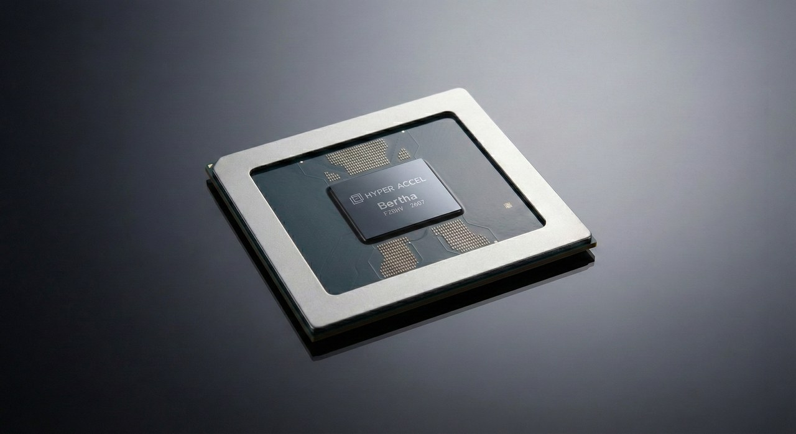

### 개요

안녕하세요? HyperAccel CL(Compute Library)팀 박현준입니다. [1편]()에서는 `torch.compile()` 이 어떻게 동작하는지, [2편]()에서는 왜 세 단계로 나뉘어 있고 누가 그 구조를 활용하는지 살펴봤습니다. 이번 편은 예고해 드린 대로 10월 20~21일 미국 산호세에서 열린 PyTorch Conference 2026을 다녀와서 쓰는 글입니다. 이 구조 위에서 업계가 지금 어디로 향하고 있는지를 정리해 보겠습니다.

이틀 동안 17개 세션을 들으며 제가 뽑은 키워드는 **Agent** 와 **Acceleration** 입니다. 먼저 밝혀 둘 점이 있습니다. 공식 분류로는 학습 세션이 가장 많았지만, 저는 컴파일러와 추론, 가속기 세션을 골라 들었습니다. 그래서 이 글은 컨퍼런스 전체의 요약이 아니라 **제가 고른 세션을 바탕으로 한 해석** 입니다. 직접 듣지 못한 세션은 공개된 소개를 근거로 쓰고, 본문에 그렇게 표시하겠습니다.

글은 세 부분으로 구성했습니다.

1. 에이전트로 개발 속도가 빨라지면서, 프로젝트들이 **Continuous Integration(CI)** 과 구조를 어떻게 바꾸고 있는가
2. PyTorch와 vLLM은 무엇을 더 빠르게 만들고 있는가
3. **Neural Processing Unit(NPU)** 회사들은 어떤 도구를 만들어 PyTorch 생태계에 들어오고 있는가

---

## Part 1. Agent: 빨라진 개발 속도를 감당하기 {#part1}

### 병목이 리뷰로 옮겨 가다

제가 들은 vLLM Roadmap 세션에서 새 기능만큼 인상적이었던 화두는 **프로젝트 관리** 였습니다. 커밋과 기여자가 늘어 릴리스와 관리 방식을 전면 개편하고 있다는 이야기였습니다. 얼마나 늘었는지 GitHub에서 10월 한 달 동안 만들어진 **Pull Request(PR)** 수를 직접 세어 봤습니다.

| 저장소 | 2024년 10월 | 2025년 10월 | 2026년 10월 |
| --- | ---: | ---: | ---: |
| vllm-project/vllm | 453 | 1,323 | 4,577 |
| pytorch/pytorch | 1,711 | 1,900 | 2,887 |

*GitHub 검색 기준이며 봇이 만든 PR도 포함합니다.*

vLLM은 2년 만에 약 10배가 되었습니다. 이 숫자 전부가 에이전트 덕분은 아닙니다. 프로젝트 자체의 성장도 함께 반영된 값이고, 어떤 PR을 에이전트가 썼는지는 이 집계로 알 수 없습니다. 다만 메인테이너들의 고민은 분명했습니다. PyTorch의 [Fighting Agents with Agents](https://pytorch.org/blog/core-pytorch-sessions-at-pytorch-conference-north-america-2026/) 세션 소개는 메인테이너가 리뷰할 에이전트 작성 PR이 계속 늘고 있다는 말로 시작합니다.

코드를 쓰는 비용이 내려가면 **비싼 일은 그 코드를 읽고 믿고 유지하는 일** 이 됩니다. 프로젝트들의 첫 대응은 규칙이었습니다. [vLLM 기여 가이드](https://docs.vllm.ai/en/v0.28.0/contributing/)는 "pure agent" PR을 제출하지 말라고 하고, 변경된 모든 줄을 검토하고 동작을 끝까지 검증할 책임이 제출한 사람에게 있다고 명시합니다.

### CI: 에이전트로 에이전트를 상대하다

규칙만으로는 늘어나는 양을 막을 수 없으니 CI와 리뷰 과정도 바뀌고 있습니다. 이 절의 세션들은 제가 직접 듣지 못해 공개된 소개를 기준으로 정리했습니다.

- **Fighting Agents with Agents: Bringing Claude to PyTorch CI, triage, and PR review:** PyTorch 인프라에 이슈 자동 분류, PR 리뷰 스킬, CI 실패와 자동 되돌림(autorevert) 조사를 넣었습니다. 목표는 메인테이너를 대체하는 것이 아니라 돕는 것이라고 합니다.
- **Shipping PyTorch and Its Ecosystem: A Modern Release Story:** Triton과 vLLM을 PyTorch nightly에 맞춰 계속 검증해, 깨지는 지점을 릴리스 브랜치 전에 찾습니다. 에이전트가 CI 실패를 분류하고 수정안을 쓰더라도 최종 결정은 사람이 내립니다.

두 세션에서 공통으로 눈에 띈 것은 사람의 역할을 남겨 두는 위치입니다. 에이전트는 분류와 조사, 초안을 맡고 **판단은 사람이 합니다.** vLLM도 제한된 자원 때문에 새 커밋마다 전체 CI를 돌리지 않고, 리뷰어나 승인된 PR의 작성자가 `/ci run` 으로 실행하게 해 두었습니다.

### 리팩토링: 여러 사람이 기여할 수 있는 구조로

기여자가 늘면 코드 구조도 부담이 됩니다. 모두가 건드리는 곳에 예외 처리가 쌓일수록 리뷰는 어려워지고 충돌은 늘어납니다.

[A Developer's Guide to Attention in vLLM](https://events.linuxfoundation.org/pytorch-conference-north-america/program/schedule/?id=1254038)이 좋은 예입니다. 어텐션은 종류마다 메타데이터와 **Key-Value(KV)** 캐시 배치가 달라서 백엔드와 커넥터 코드에 분기가 늘고 있었습니다. 그래서 공통 메타데이터(`CommonAttentionMetadata`)를 실행 단계마다 한 번 만들고, 각 백엔드는 필요한 정보만 덧붙이도록 바꿨습니다. KV의 논리적 차원은 `L, B, H, N, C` 로 통일하고 실제 메모리 배치는 stride로 표현합니다. 논리 형태와 물리 배치를 분리하면 새 어텐션이나 새 저장 방식을 추가할 때 고칠 곳이 줄어듭니다.

로드맵에서 소개한 Flat Model과 Model Runner V2도 같은 방향의 모델 실행 구조 개편입니다. 공개된 세션 소개 기준으로는 [One Model Definition, Many Accelerators](https://pytorch.org/blog/vllm-sessions-at-pytorch-conference-north-america-2026/)가 모델 로직을 하드웨어 실행 경로에서 분리해, 같은 모델 정의를 Intel Gaudi와 IBM Spyre에서 플랫폼별 코드 없이 돌린다고 합니다.

발표들은 이 작업들을 주로 새 모델과 새 구조를 쉽게 지원하기 위한 것으로 설명했습니다. 저는 여기에 다른 의미도 있다고 봅니다. 경계가 분명한 구조는 **사람에게도 에이전트에게도 기여하기 쉬운 구조** 입니다. 고칠 범위가 좁을수록 변경을 검증하기도 쉽기 때문입니다.

---

## Part 2. Acceleration: PyTorch와 vLLM은 어디를 빠르게 만들고 있나 {#part2}

Part 1이 개발 속도의 이야기였다면, Part 2는 실행 속도의 이야기입니다. 눈에 띈 변화는 최적화의 대상이 **생성된 코드의 속도** 에서 컴파일 비용과 런타임 전체로 넓어졌다는 점입니다.

### 컴파일을 빠르게: FakeTensor와 graph break

[Speeding Up torch.compile: A New FakeTensor](https://events.linuxfoundation.org/pytorch-conference-north-america/program/schedule/?id=1257046)부터 보겠습니다. FakeTensor는 실제 데이터 없이 shape, dtype, device 같은 메타데이터만 계산하는 텐서입니다. Dynamo는 그래프를 추적하면서 연산마다 이 계산을 하고, Inductor도 코드를 만드는 과정에서 씁니다. 세션 소개에 따르면 이 전파가 Dynamo 추적 시간의 약 20%를 차지합니다.

해법은 FakeTensor를 C++로 새로 구현하는 것입니다. 파이썬 디스패치와 심볼릭 연산에서 생기는 부가 비용을 줄인 결과, 연산 118개의 기하평균이 48.2µs에서 2.2µs로 **22.3배** 빨라졌습니다. 다만 이것은 연산 단위 측정값입니다. torchbench 전체 컴파일 시간 기준의 개선 폭은 설정별로 3.7~11.6%이고, 개별 모델은 20~30%까지 좋아진다고 발표했습니다. 새로운 알고리즘이 아니라 구현 경로를 바꾼 것만으로 이 정도 개선이 나왔다는 점이 제게는 인상적이었습니다. 남은 파이썬 메타 커널을 C++로 옮기는 작업이 다음 단계인데, 슬라이드에 적힌 계획은 "Use Agents!"였습니다. Part 1의 흐름이 여기서 다시 나타납니다.

graph break 쪽도 움직이고 있습니다. 1편에서 graph break가 나면 그래프가 짧아져 융합 범위가 좁아진다고 말씀드렸는데, 호출 깊이가 깊을수록 문제가 커집니다. [Nested Graph Breaks](https://pytorch.org/blog/core-pytorch-sessions-at-pytorch-conference-north-america-2026/) 세션 소개에 따르면, 깊이 N인 함수 호출에서 O(N)번 생기던 중복 graph break를 O(1)로 줄여 더 큰 그래프를 캡처할 수 있게 되었습니다.

반대로 Dynamo가 필요 없는 경우를 위한 길도 생겼습니다. [Lightweight FX Tracing in PyTorch](https://events.linuxfoundation.org/pytorch-conference-north-america/program/schedule/?id=1256183)는 전체 그래프를 얻으려는 사용자에게 Dynamo가 너무 무겁다는 피드백에서 출발합니다. 그래서 `make_fx` 기반의 경량 추적 경로를 제안합니다. 이는 Dynamo의 대체재가 아니라, CUDA Graph로 재실행할 수 있는 작업처럼 조건이 맞는 경우를 위한 경로입니다.

### 동적 shape: guard를 없애야 하는 곳

이어지는 두 세션은 제가 듣지 못해 소개를 기준으로 정리했습니다. 1편에서 Dynamo는 가정이 깨졌는지를 guard로 검사하고, 깨지면 재컴파일한다고 설명했습니다. 그런데 서빙 환경에서는 입력 길이가 매번 바뀌고, 그때마다 재컴파일할 수는 없습니다.

[From Backed to Unbacked](https://pytorch.org/blog/core-pytorch-sessions-at-pytorch-conference-north-america-2026/) 세션은 이런 환경을 위한 **unbacked shape** 을 다룹니다. 기존 backed shape은 예시 입력의 값을 힌트로 삼기 때문에 암묵적인 guard와 재컴파일이 생길 수 있습니다. unbacked shape은 동적 shape에 대한 암묵적 guard를 허용하지 않습니다. 대신 기존 방식과의 성능 격차를 줄이는 것이 과제입니다. [Parametrized Dynamic Shape CUDA Graphs](https://pytorch.org/blog/core-pytorch-sessions-at-pytorch-conference-north-america-2026/)는 torch.compile의 심볼릭 추적과 guard를 활용해 CUDA Graph 하나를 여러 shape에 재사용합니다. 서빙의 콜드 스타트를 줄이는 효과도 보고되었습니다. 두 작업 모두 그래프 위의 정보를 런타임까지 끌고 내려간다는 점에서 1편의 구조가 확장된 모습입니다.

### 실행을 빠르게: 에이전트 워크로드와 vLLM

에이전트는 개발 방식만이 아니라 워크로드도 바꾸고 있습니다. 에이전트 요청은 문맥이 길고, 대화와 도구 호출이 여러 번 이어지며, 도구를 기다리는 동안 GPU 연산이 멈춰도 KV 상태는 계속 필요합니다. 이 특성이 vLLM 쪽 연구의 방향을 만들고 있었습니다.

- **더 적게 기다리기:** vLLM Roadmap은 GPU가 CPU 동기화 때문에 멈추지 않게 하는 작업, 커널 융합과 메가커널(mega-kernel)을 소개했습니다.
- **한 번에 여러 토큰 확인하기:** What's New in Inference in October와 기업용 추론 세션은 추측 디코딩(speculative decoding)을 응답 속도를 높이는 수단으로 다뤘습니다.
- **KV를 오래, 싸게 유지하기:** [Native Tiered KV Cache Offloading in vLLM](https://events.linuxfoundation.org/pytorch-conference-north-america/program/schedule/?id=1254938)은 CPU 메모리를 허브로 삼아 GPU 메모리를 먼저 비우고, 저장소나 다른 노드로의 전송은 비동기로 처리합니다.

이 항목들은 torch.compile 혼자서 해결하는 문제가 아닙니다. 예를 들어 KV 오프로딩은 프롬프트 캐시를 늘려 줄 뿐 그 자체로 디코드 처리량을 높이지는 않습니다. TPU 메가커널 데모도 커널 최적화는 전체의 일부이며, 프리필과 디코드 분리, 캐시 재사용이 함께 필요하다고 설명했습니다. 커널 하나의 속도만 재서는 부족하다는 메시지를 여러 세션에서 반복해 들었습니다.

### 두 키워드가 만나는 곳

Agent와 Acceleration은 커널 최적화에서 직접 만납니다. 제가 듣지 못한 세션이고 수치는 [발표 소개](https://pytorch.org/blog/agentic-ai-and-next-gen-intelligence-sessions-at-pytorch-conference-north-america-2026/)에 보고된 값입니다. **KernelAgent** 는 GPU 하드웨어 성능 신호를 받는 멀티 에이전트로 Triton 커널을 고쳐, 기본 torch.compile 대비 평균 1.56배 빠른 결과를 냈다고 합니다. Helion 자동 튜닝 세션은 LLM이 제안한 후보를 함께 쓰는 탐색으로 튜닝 시간을 최대 10배 줄였다고 합니다. 컴파일러가 혼자 내리던 선택을 에이전트가 반복 실험으로 다듬는 방향입니다. 다만 커널 생성 성공률과 실제 성능, 수치 정확성은 구분해서 봐야 합니다.

---

## Part 3. NPU 회사들은 어떻게 생태계 안으로 들어오는가 {#part3}

2편에서는 각 회사가 **세 단계 중 어디로 들어오는가** 를 비교했습니다. 이번 컨퍼런스에서 느낀 점은 그 다음 단계로 경쟁이 옮겨 갔다는 것입니다. 연결된 뒤에 무엇을 만들고 있는지를 Huawei 발표의 틀로 정리해 보겠습니다.

[Boosting PyTorch's Heterogeneous Compute Ecosystem](https://events.linuxfoundation.org/pytorch-conference-north-america/program/schedule/?id=1348281) 발표는 대부분의 코드가 GPU 중심이라 NPU가 들어오기 어렵다는 문제에서 출발합니다. 그리고 과제를 **Integrate, Perform, Verify** 세 가지로 나눕니다. 하드웨어 지원이란 연산자가 실행되는 것으로 끝나지 않고, 분산 실행과 컴파일, 테스트까지 포함한다는 뜻입니다. 함께 NPU 생태계를 만들어 갈 사람을 찾는다고 말한 것도 기억에 남습니다.

### Integrate: 공통 인터페이스에 연결하기

연결의 기본은 2편에서 다룬 PrivateUse1입니다. 여기에 참고 구현인 OpenReg와 장치 공통 API인 `torch.accelerator` 가 더해지면서, 벤더가 따라갈 길이 공식 경로로 다져지고 있습니다. `torch.accelerator` 는 CUDA 전용으로 작성된 분기 코드를 장치 독립적인 코드로 바꾸기 위한 것입니다. Huawei는 이 위에 FSDP2, DTensor, 통신 백엔드를 연결해 분산 학습까지 지원하고 있습니다.

### Perform: Inductor를 넓히는 Spyre

성능 쪽에서는 IBM Spyre 사례가 가장 구체적이었습니다. 2편에서 Spyre가 Inductor의 코드 생성 단계를 활용한다고 소개했는데, [Integrating the IBM Spyre Accelerator](https://events.linuxfoundation.org/pytorch-conference-north-america/program/schedule/?id=1256168) 발표와 [IBM의 공식 글](https://pytorch.org/blog/extending-inductor-for-the-ibm-spyre-accelerator/)에서 그 실체를 볼 수 있었습니다.

Spyre는 코어 32개가 각자 2MB 스크래치패드를 가진 데이터플로우 가속기입니다. 데이터는 128바이트 단위의 stick으로 움직이고, 코어별 작업 분할도 컴파일 시점에 정해야 합니다. 그래서 Inductor의 GPU 중심 가정이 세 곳에서 맞지 않았습니다. 텐서 레이아웃, 스크래치패드 관리, 코어 배정입니다. torch-spyre는 이 세 문제를 스케줄링 이전의 커스텀 패스로 풀고, 나머지는 Inductor를 그대로 재사용합니다.

그 결과 예전 자체 컴파일러 스택의 약 27만 3천 줄이 약 3만 8,600줄로, **약 7분의 1** 이 되었습니다. 실행 속도가 7배 빨라졌다는 뜻이 아니라 코드 규모가 줄었다는 의미입니다. IBM도 Inductor를 그대로 끼운 것이 아니라 상당한 확장이 필요했다고 밝히고 있습니다. 특히 핵심 패스는 아직 monkey-patch로 연결되어 있어 정식 확장 지점으로 만드는 논의를 upstream과 진행 중입니다. 오픈소스로 공개한 타일 IR인 [KTIR](https://pytorch.org/blog/your-guide-to-hardware-acceleration-compute-infrastructure-at-pytorch-conference-north-america-2026/)과 [장치별 텐서 레이아웃](https://pytorch.org/blog/core-pytorch-sessions-at-pytorch-conference-north-america-2026/) 제안도 같은 흐름입니다. 벤더가 자기 문제를 풀면서 만든 확장을 upstream으로 되돌리고 있습니다.

모두가 같은 길을 가는 것은 아닙니다. 다음은 공개된 세션 소개와 기사를 기준으로 정리한 비교입니다.

| | 연결 방식 | torch.compile과의 접점 | 대표 도구 |
| --- | --- | --- | --- |
| **Huawei Ascend** | PrivateUse1 | Inductor와 Triton 코드 생성 | 정밀도 검증 도구, CRCR 활용 |
| **IBM Spyre** | PrivateUse1 + OpenReg | Inductor 확장 + MLIR 백엔드 | KTIR, Dataflow Scheduler |
| **AWS Trainium** | PrivateUse1 | 서브모듈 단위 컴파일 | TorchNeuron |
| **Google TPU** | 디스패처 연동 | ATen을 StableHLO로 낮추는 경로 | TorchTPU |

Google의 TorchTPU는 ATen에서 StableHLO로 내려가는 경로를 소개했습니다. 다만 디바이스 이름만 바꾼다고 최고 성능이 나오는 것은 아니며, shape과 샤딩, 연산에 남은 GPU 전제를 고쳐야 한다는 점도 함께 밝혔습니다. 국내 회사로는 Rebellions가 스폰서 세션을 열었습니다. 공개된 소개에 따르면 device-persistent tensor로 서빙 중 host와 device 사이의 전송을 줄이는 내용입니다.

### Verify: 정확성을 확인하고 upstream을 따라가기

연결과 성능 못지않게 강조된 것이 검증입니다. 먼저 수치 검증입니다. Huawei의 [Advancing torch.compile for Verifiable Precision & Dynamic Shapes](https://events.linuxfoundation.org/pytorch-conference-north-america/program/schedule/?id=1253426) 발표는 컴파일 결과가 eager의 수치 동작을 얼마나 보존하는지를 묻습니다. 누적 순서, 산술식 변환, 자료형 승격 때문에 같은 수식도 결과가 달라질 수 있습니다. Scheduler Anchored Kernel Verifier는 스케줄링 과정의 FX 의미를 기록해 두고, 같은 입력을 참조 그래프와 생성 커널에 넣어 비교합니다. 불일치가 나면 재현 자료를 남깁니다.

다음은 upstream을 따라가는 문제입니다. Part 1의 CI가 여기서 다시 등장합니다. **Cross-Repository CI Relay(CRCR)** 는 PyTorch의 PR 이벤트를 외부 저장소로 전달해, 머지 전에 외부 백엔드와의 호환성을 확인하는 장치입니다. 세션 소개에 따르면 Ascend와 RISC-V 백엔드에서 깨짐을 발견하는 시간이 며칠에서 몇 분으로 줄었습니다. Huawei는 여기에 장치 독립적 테스트 재사용을 더해, 58만 개가 넘는 커뮤니티 테스트를 활용하고 upstream 업데이트 후 30일 안에 안정 버전을 낸다고 합니다.

제게 가장 흥미로웠던 사례는 이 지점에서 Agent와 만납니다. Spyre는 CRCR의 네 단계 중 L2에 도달했는데, [공개된 글](https://pytorch.org/blog/from-upstream-changes-to-downstream-confidence-inside-torch-spyres-integration-with-pytorch-crcr/)에 따르면 수만 개의 PyTorch 테스트 중 자기 하드웨어에 의미 있는 것을 **에이전트 파이프라인으로 골랐습니다.** 선택 이유는 사람이 리뷰할 수 있도록 설정 파일에 남기고, 실제 하드웨어에서 돌린 로그로 다시 분류합니다. PyTorch 2.13에서 2.14로 올릴 때는 바뀐 테스트 약 4,000개만 평가하면 되었다고 합니다. Part 1에서 본 "에이전트가 제안하고 사람이 판단하는 구조"가 NPU 회사의 생태계 합류에도 그대로 쓰이고 있는 것입니다.

---

## Conclusion

이번 컨퍼런스를 두 키워드로 정리해 보겠습니다. **Agent** 는 코드를 만드는 비용을 낮췄고, 그 결과 검증과 구조가 더 중요해졌습니다. **Acceleration** 은 생성 코드에서 컴파일 비용과 런타임 전체로 범위를 넓혔습니다. 그리고 NPU 회사들은 이 두 흐름이 쌓이는 공통 기반 안으로 들어와, 자기 문제를 푼 결과를 다시 upstream에 돌려주고 있습니다. 2편에서 본 "바깥으로 열린 길"을 지금은 더 많은 회사가 함께 넓히고 있는 셈입니다.

칩을 만드는 회사의 개발자로서 느낀 점은 두 가지입니다. 첫째, 필요한 기능이 이미 PyTorch나 vLLM에 있거나 개발 중일 가능성이 높습니다. 무엇을 만들기 전에 공통 기반에서 먼저 찾아봐야 합니다. 둘째, 공통 기반을 쓰더라도 하드웨어별 판단은 사라지지 않습니다. Spyre가 보여 주듯 재사용으로 줄어든 시간은 하드웨어에 특화된 어려운 문제로 옮겨 갑니다. 2편에서 말씀드린 대로 저희 LPU는 정규화된 그래프를 받아 [Legato]()로 커널을 만듭니다. 이 구조에서 어디까지를 공통 기반에 맡기고 어디를 직접 만들 것인지를 계속 고민하게 된 이틀이었습니다.

이렇게 세 편에 걸친 `torch.compile()` 이야기를 마칩니다. 이 분야의 변화가 워낙 빨라 내년 이맘때면 이 글의 절반은 옛날이야기가 되어 있을지도 모르겠습니다. 긴 글 읽어주셔서 감사합니다.

## Reference

**컨퍼런스 공식 자료**

- [PyTorch Conference North America 2026 리캡](https://www.pytorch.org/blog/pytorch-conference-north-america-2026-accelerating-open-intelligence-together)
- [Core PyTorch Sessions](https://pytorch.org/blog/core-pytorch-sessions-at-pytorch-conference-north-america-2026/)
- [vLLM Sessions](https://pytorch.org/blog/vllm-sessions-at-pytorch-conference-north-america-2026/)
- [Agentic AI and Next-Gen Intelligence Sessions](https://pytorch.org/blog/agentic-ai-and-next-gen-intelligence-sessions-at-pytorch-conference-north-america-2026/)
- [Hardware Acceleration & Compute Infrastructure Guide](https://pytorch.org/blog/your-guide-to-hardware-acceleration-compute-infrastructure-at-pytorch-conference-north-america-2026/)

**발표 자료**

- [A Developer's Guide to Attention in vLLM (PDF)](https://sessionize.com/download/inrafsed~NeBAc63TLXzTxrF9c3MmwR.pdf~a-developers-guide-to-attention-in-vllm.pdf)
- [Speeding Up torch.compile: A New FakeTensor (PDF)](https://sessionize.com/download/icpakbex~fQvBrdWRtMhCbgNzRwhrvg.pdf~cpp-faketensor-pytorch-conference-na-26.pdf)
- [Lightweight FX Tracing in PyTorch (PDF)](https://sessionize.com/download/kyadqeo~fgCQhdDpNxNr1EzEpC3Xdj.pdf~light-weight-fx-tracing-in-pytorch-ptc-26.pdf)
- [Integrating the IBM Spyre Accelerator (PDF)](https://sessionize.com/download/ickazseq~HyY4icEtmAdSeRgNSBjyYB.pdf~integratingibmspyre.pdf)

**문서와 기사**

- [vLLM Contributing Guide](https://docs.vllm.ai/en/v0.28.0/contributing/)
- [Extending Inductor for the IBM Spyre Accelerator](https://pytorch.org/blog/extending-inductor-for-the-ibm-spyre-accelerator/)
- [From Upstream Changes to Downstream Confidence](https://pytorch.org/blog/from-upstream-changes-to-downstream-confidence-inside-torch-spyres-integration-with-pytorch-crcr/) — Spyre의 CRCR 통합
- [Google and Meta open-source TorchTPU (InfoQ)](https://infoq.com/news/2026/10/google-meta-torchtpu)

**HyperAccel**

- [Legato 문서](https://legato-docs.hyperaccel.net/latest/)
- [PyTorch Conference 2025 참관기]()

## 추신: HyperAccel은 채용 중입니다!

HyperAccel은 LPU라는 새로운 칩을 만드는 회사이지만, 동시에 소프트웨어의 최신 흐름을 가장 가까이에서 따라가며 개발하는 팀이기도 합니다. 이번 글에서 다룬 것처럼 새로운 하드웨어를 둘러싼 소프트웨어 스택은 지금도 빠르게 바뀌고 있고, 저희는 그 최전방에서 일하고 있습니다.

사용자가 새로운 디바이스를 기존 방식 그대로, 편하게 사용할 수 있도록 만드는 연구와 개발에 함께하고 싶으시다면 [HyperAccel Career](https://hyperaccel.career.greetinghr.com/ko/guide)로 지원해 주세요!
